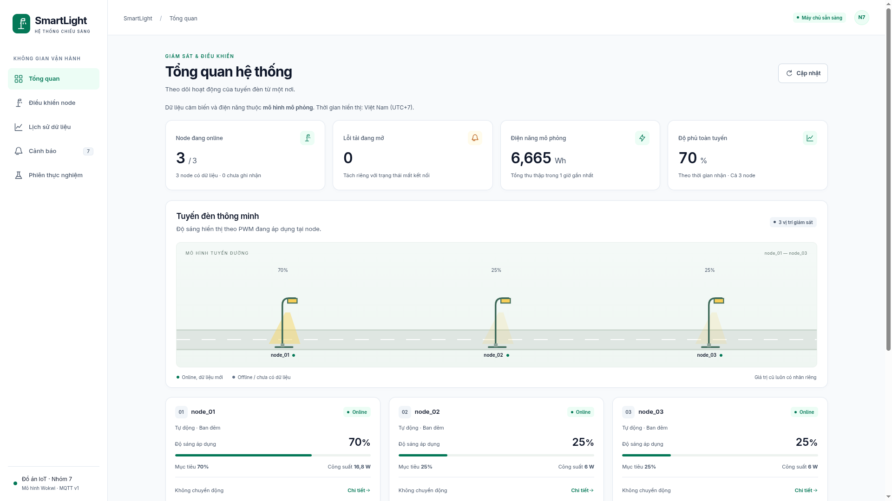

# Hướng dẫn cài đặt và vận hành dự án đèn đường thông minh

Tài liệu thực hành toàn bộ hệ thống ba node ESP32 trên Wokwi, MQTT Mosquitto, FastAPI và SQLite, dashboard HTML CSS JavaScript qua VS Code Live Server.

Dành cho thành viên Nhóm 7 và người tiếp nhận dự án. Làm theo thứ tự cài đặt lần đầu, sau đó dùng trang khởi động nhanh cho những lần chạy tiếp theo. Mỗi thao tác có nơi thực hiện, kết quả cần quan sát và cách xử lý khi chưa đạt.

Phiên bản 1.0 • Ngày 18 tháng 11 năm 2026 • TASK 015

Hệ thống đã có bộ nghiệm thu mô phỏng TASK-011 và TASK-012. Các lệnh Windows được đối chiếu với source và hướng dẫn của dự án; lần kiểm tài liệu này không cài lại Windows hoặc chạy lại toàn bộ mô phỏng. Các ảnh minh họa là ảnh QA đã ghi, không phải trạng thái của máy đang mở.

Bản Word chỉnh sửa được trong WPS hoặc Microsoft Word. Bản Markdown đi kèm để tìm kiếm và sao chép các lệnh dài. PDF có thể xuất từ WPS khi cần nộp.

<!-- PAGE -->
# Mục lục và cách dùng

| Phần | Nội dung |
|---|---|
| 1 đến 4 | Kiến trúc, thư mục, cài Linux và Windows, cấu hình và cổng |
| 5 đến 10 | Broker, backend, khởi tạo SQLite, build, Wokwi và khởi động nhanh |
| 11 đến 17 | Cảm biến, AUTO, tổng quan, điều khiển, lịch sử, cảnh báo và phiên đo |
| 18 đến 22 | API, lệnh, năng lượng, thực nghiệm thủ công và công cụ QA |
| 23 đến 26 | Kiểm thử, xử lý lỗi, dừng và khởi động lại |
| 27 đến 29 | Sao lưu SQLite, khôi phục gói bàn giao và chuyển máy |
| 30 và phụ lục | Tìm source, checklist vận hành và tài liệu tham chiếu |

Trong Word hoặc WPS, mở Navigation hoặc Đề mục để nhảy đến tiêu đề. Các phần chính bắt đầu ở trang mới; số trang nằm ở chân trang.

Quy ước lệnh: Bash dùng cho Linux, PowerShell dùng cho Windows. Khối ghi “cả hai hệ điều hành” có thể gõ nguyên lệnh trong hai loại terminal. Không gõ ký hiệu đánh dấu khối mã. Đường dẫn chứa khoảng trắng phải đặt trong dấu nháy.

Ký hiệu DoAn là thư mục cha chứa ba repo. Ví dụ Linux có thể là /home/ten-ban/DoAn, Windows có thể là D:\DoAn. Thay bằng vị trí trên máy mình. Mỗi khối lệnh đều nêu thư mục làm việc; không mặc định mọi lệnh chạy trong firmware.

Chạy hằng ngày không cần Node.js, npm, Playwright hoặc các helper trong output/task-012. Chỉ cần những thành phần runtime ở phần 2 đến 10. Node.js dùng cho kiểm thử dashboard và công cụ QA nâng cao; WPS dùng đọc tài liệu, không phải thành phần của hệ thống điều khiển.

<!-- PAGE -->
# 1 Kiến trúc và vị trí các thành phần

Dữ liệu đi theo luồng cảm biến → ESP32 → MQTT → backend → SQLite → dashboard. Lệnh đi ngược từ dashboard → HTTP API → MQTT → node → ACK. Quyết định AUTO nằm ở từng ESP32; backend không tính mức PWM thay node.

```text
DoAn/
  firmware/
    platformio.ini
    src/                  source Arduino dùng chung
    simulations/node_01/  diagram.json và wokwi.toml
    simulations/node_02/
    simulations/node_03/
    infra/compose.yaml
    docs/ và scripts/
  backend/
    smartlight/           API và xử lý dữ liệu
    requirements.txt
    data/                 SQLite cục bộ
  dashboard/
    index.html
    config.js
    css/ và js/
    .vscode/settings.json
```

Ba thư mục là ba repo độc lập. Lấy đủ source từ bản bàn giao hoặc từ remote thật của nhóm; không có một URL clone chung được giả định ở tài liệu này. Nếu dùng Git, kiểm git status trước khi pull và xử lý thay đổi đang làm trước khi đồng bộ; pull từng repo từ đúng thư mục.

Một source firmware tạo ba binary theo environment. Không sao chép src cho từng node. Wokwi chạy binary đã build, không trực tiếp biên dịch C++. Dashboard là tệp tĩnh; mở bằng Live Server, không dùng npm start hoặc file://.

Giới hạn mô hình: khoảng cách tạo quy ước người/xe; biến trở giả lập tải; công suất và điện năng là kết quả tính toán. Sơ đồ này không phải thiết kế driver đèn công suất hoặc dây điện dùng với ESP32 thật.

<!-- PAGE -->
# 2 Chuẩn bị trên Linux

Cài VS Code chính thức, Git, Python 3.12 cùng hỗ trợ venv, Docker Engine và Compose plugin theo hướng dẫn phù hợp bản phân phối. Không mặc định Python hệ thống đã là 3.12. Nếu chỉ có 3.13 hoặc 3.14, cài thêm 3.12 để dùng backend, giữ Python hệ thống.

Trong VS Code, mở Extensions bằng Ctrl+Shift+X, cài PlatformIO IDE của PlatformIO, Wokwi Simulator của Wokwi và Live Server của Ritwick Dey. Chờ PlatformIO cài xong Core; dùng terminal PlatformIO để có lệnh pio. Không tạo New Project ghi đè thư mục firmware hiện có.

Kiểm tra từ terminal bình thường:

```bash
git --version
python3.12 --version
docker version
docker compose version
```

Docker version phải có cả thông tin Client và Server. Nếu Server không kết nối được, khởi động Docker bằng cơ chế của máy trước. Permission denied ở socket là vấn đề quyền/context; không chữa bằng chmod 666 socket.

Trong terminal PlatformIO của VS Code:

```bash
pio --version
```

Nếu terminal thường chưa nhận pio nhưng PlatformIO đã cài xong, dùng terminal PlatformIO hoặc đường dẫn Core mặc định sau khi kiểm tệp tồn tại:

```bash
~/.platformio/penv/bin/pio --version
```

Trình duyệt cần mở được dashboard local. Internet được dùng khi cài package/image và chạy Wokwi với quyền tài khoản phù hợp; broker local không đồng nghĩa mô phỏng hoạt động hoàn toàn offline. Wokwi license được kích hoạt ở phần 9. WPS có thể dùng để đọc/chỉnh tài liệu.

<!-- PAGE -->
# 3 Chuẩn bị trên Windows

Cài VS Code, Git for Windows, Python 3.12 và Docker Desktop từ nguồn chính thức. Hoàn tất yêu cầu hệ thống của Docker Desktop theo máy, mở ứng dụng và chờ Engine sẵn sàng. Dùng PowerShell cho các khối lệnh Windows. Cài ba extension PlatformIO IDE, Wokwi Simulator và Live Server như phần 2.

```powershell
git --version
py -3.12 --version
docker version
docker compose version
```

Nếu không có lệnh py, dùng đường dẫn python.exe của đúng Python 3.12. Không thay bằng một Python khác chỉ vì lệnh chạy được. Backend yêu cầu >=3.12 và <3.13 trong pyproject.toml.

Mở thư mục firmware trong VS Code, chờ PlatformIO cài Core. Mở PlatformIO terminal rồi chạy pio --version. Nếu cần gọi trực tiếp từ PowerShell và Core nằm ở vị trí mặc định:

```powershell
& "$env:USERPROFILE\.platformio\penv\Scripts\platformio.exe" --version
```

Tài liệu gọi trực tiếp .venv/Scripts/python.exe thay vì activate.ps1. Vì vậy không cần đổi ExecutionPolicy để chạy backend. Không trộn venv Windows với venv Linux hoặc sao chép .venv từ máy khác.

Nên chạy cả backend, Docker, VS Code và trình duyệt trên cùng môi trường host đã chọn. Nếu dùng WSL, đường loopback, Docker context và Wokwi gateway cần được kiểm lại; các lệnh PowerShell trong sách không chứng minh cấu hình chia đôi Windows/WSL đã hoạt động.

Các bước MQTT trong phần 5 dùng docker compose exec để tránh phụ thuộc host networking của service mqtt-client trên Windows. Việc sub/pub trong container chỉ kiểm broker nội bộ; vẫn phải kiểm cổng host và telemetry thật từ Wokwi.

<!-- PAGE -->
# 4 Cấu hình cố định và bảng cổng

| Thành phần | Giá trị chạy thông thường |
|---|---|
| MQTT trên máy host | 127.0.0.1:1883 |
| MQTT từ ESP32 Wokwi | host.wokwi.internal:1883 |
| API backend | http://127.0.0.1:8000 |
| Swagger | http://127.0.0.1:8000/docs |
| Dashboard Live Server | http://127.0.0.1:5500/ |
| Serial node_01 / node_02 / node_03 | RFC2217 cổng 4000 / 4001 / 4002 |
| Environment ba node | esp32dev / node_02 / node_03 |

Source đã khóa Espressif32 8.0.0, Arduino package 4.30312.261113, ESP32 libs 3.3.12, PubSubClient 2.8.0 và ArduinoJson 7.4.2. Giữ platformio.ini; không tự nâng package khi đang dùng bộ nghiệm thu.

Backend đọc các biến sau từ môi trường của chính terminal khởi động:

```text
SMARTLIGHT_DB=data/smartlight.db
SMARTLIGHT_MQTT_HOST=127.0.0.1
SMARTLIGHT_MQTT_PORT=1883
SMARTLIGHT_ORIGINS=http://localhost:5500,http://127.0.0.1:5500
```

Không cần khai báo lại nếu dùng mặc định. Mặc định CORS còn hỗ trợ cổng 5173 lịch sử; dashboard hiện chạy 5500. File backend/.env.example chỉ là mẫu tham khảo, ứng dụng không tự đọc file .env.

Nếu chủ động đổi API sang 8001, phải đổi cả tham số --port của uvicorn và API_BASE_URL trong dashboard/config.js. CORS là origin của trang web 5500, không phải cổng API. Không đổi hostname MQTT trong firmware thành 127.0.0.1 vì localhost trong ESP32 mô phỏng không phải host.

Đợt QA TASK-012 dùng API 8001, SQLite riêng và cổng helper 18771–18773/CDP 19222–19224. Đây không phải các cổng cần mở cho chạy thông thường. Kiểm cổng đang dùng trước khi chạy, không dừng nhầm ứng dụng khác.

<!-- PAGE -->
# 5 Khởi động và kiểm tra broker MQTT

Thư mục làm việc: DoAn/firmware. Các lệnh dưới dùng được trong Bash và PowerShell.

```text
docker compose -f infra/compose.yaml config --quiet
docker compose -f infra/compose.yaml pull mosquitto
docker compose -f infra/compose.yaml up -d mosquitto
docker compose -f infra/compose.yaml ps
docker compose -f infra/compose.yaml port mosquitto 1883
docker compose -f infra/compose.yaml logs --tail=30 mosquitto
```

Kỳ vọng container chạy, mapping là 127.0.0.1:1883. Compose dùng eclipse-mosquitto:2.1.2-alpine, mount cấu hình read-only, persistence false và không tự restart. Anonymous dành cho demo local; giữ publish loopback, không mở listener ra Internet.

Mở terminal A trong firmware, nghe trước:

```text
docker compose -f infra/compose.yaml exec -T mosquitto mosquitto_sub -h 127.0.0.1 -t huit/nhom7/smartlight/v1/diagnostics/broker -C 1 -W 30 -v
```

Terminal B trong firmware:

```text
docker compose -f infra/compose.yaml exec -T mosquitto mosquitto_pub -h 127.0.0.1 -t huit/nhom7/smartlight/v1/diagnostics/broker -m setup-check-001
```

Terminal A phải nhận đúng setup-check-001. Topic diagnostics này không phải telemetry nghiệp vụ. Không thêm retain. Để kiểm cổng host: Linux dùng ss -ltn với cổng 1883; Windows dùng Test-NetConnection 127.0.0.1 -Port 1883. Sau đó backend/Wokwi phải thật sự nhận dữ liệu mới.

Nếu Docker Engine chưa chạy, xử lý Engine trước. TASK-012 đã dùng broker native riêng trong QA khi daemon không hoạt động; đó là phương án của đợt kiểm, không phải yêu cầu build Mosquitto lại để chạy dự án. Không chạy đồng thời hai broker trên 1883.

<!-- PAGE -->
# 6 Cài backend và thiết lập môi trường

Thư mục làm việc: DoAn/backend. Cài lần đầu; các lần sau dùng lại venv của chính máy đó.

Linux Bash:

```bash
python3.12 -m venv .venv
.venv/bin/python -m pip install -r requirements.txt
.venv/bin/python --version
```

Windows PowerShell:

```powershell
py -3.12 -m venv .venv
.venv/Scripts/python.exe -m pip install -r requirements.txt
.venv/Scripts/python.exe --version
```

Kiểm Python ra 3.12.x. requirements.txt khóa dependency runtime và test; không dùng pip install --upgrade để thay bộ phiên bản. Nếu pip không tải được, kiểm mạng/proxy/index và giữ log thay vì thay package tùy ý.

Nếu muốn DB demo tách khỏi DB đang có, đặt biến trong cùng terminal trước khi chạy backend. Ví dụ Linux:

```bash
export SMARTLIGHT_DB=data/demo-moi.db
export SMARTLIGHT_MQTT_HOST=127.0.0.1
export SMARTLIGHT_MQTT_PORT=1883
```

PowerShell:

```powershell
$env:SMARTLIGHT_DB='data/demo-moi.db'
$env:SMARTLIGHT_MQTT_HOST='127.0.0.1'
$env:SMARTLIGHT_MQTT_PORT='1883'
```

Chọn một tên DB nhất quán từ bước khởi tạo đến khởi động. SMARTLIGHT_DB tương đối tính từ thư mục chạy backend. Một terminal khác không tự kế thừa biến vừa khai báo. Muốn trở lại mặc định, bỏ biến của terminal hoặc mở terminal mới.

<!-- PAGE -->
# 7 Khởi tạo SQLite và chạy API

Thư mục: DoAn/backend; backend phải đang dừng khi chạy init_db. Ví dụ sau dùng DB mặc định. Nếu phần 6 chọn demo-moi.db, thay đúng đường dẫn ở --db và giữ SMARTLIGHT_DB trỏ cùng tệp.

Linux:

```bash
.venv/bin/python -m smartlight.init_db --db data/smartlight.db
.venv/bin/python -m uvicorn smartlight.api:app --host 127.0.0.1 --port 8000 --workers 1
```

Windows PowerShell:

```powershell
.venv/Scripts/python.exe -m smartlight.init_db --db data/smartlight.db
.venv/Scripts/python.exe -m uvicorn smartlight.api:app --host 127.0.0.1 --port 8000 --workers 1
```

init_db in Initialized schema v1 và tạo sẵn node_01, node_02, node_03. Chạy lặp lại không xóa dữ liệu. Script nhận --db riêng, không tự lấy SMARTLIGHT_DB thay cho tham số này. Database dùng SQLite WAL, phải ở ổ local. Không cần cài PostgreSQL, MySQL hoặc Redis.

Giữ terminal uvicorn mở. Không bật --reload cho buổi demo và không tăng workers: ứng dụng dùng một collector, một OS lock theo DB. File .db.lock có thể còn khi backend đã dừng; sự tồn tại của file không có nghĩa khóa OS còn giữ. Không xóa DB hoặc lock để chữa một backend thứ hai đang chạy.

Mở http://127.0.0.1:8000/docs. Kiểm GET /api/health và /api/nodes. Health 200/OK nghĩa các thành phần backend sẵn sàng; chưa có node thì nodes vẫn có thể UNKNOWN. Health 503 khi broker/database/queue lỗi; xem các cờ và log, không nhầm với node thiếu cảm biến.

DB mới không có telemetry hoặc lịch sử giả để hiển thị. Dữ liệu thật sẽ đến khi Wokwi kết nối. Dừng API bằng Ctrl+C và đợi shutdown xong trước khởi tạo lại hoặc đổi DB.

<!-- PAGE -->
# 8 Build firmware và chuẩn bị ba node

Mở DoAn/firmware bằng VS Code, dùng terminal PlatformIO. Lệnh chung Bash hoặc PowerShell:

```text
pio run -e esp32dev -e node_02 -e node_03
```

Phải có SUCCESS cho cả ba environment. Output tương ứng ở .pio/build/esp32dev, .pio/build/node_02 và .pio/build/node_03. Hai artifact chính là firmware.bin và firmware.elf. Build không mở mô phỏng và không tự thay binary đang chạy trong Wokwi.

Sau build thành công, trong firmware chạy một trong hai lệnh theo hệ điều hành:

```bash
python3.12 scripts/prepare-simulation.py --node all
```

```powershell
py -3.12 scripts/prepare-simulation.py --node all
```

Script kiểm source/config, độ mới và SHA256, sao chép đúng binary/ELF vào simulations/node_0N/build và ghi manifest.json. Các thư mục build bị Git ignore. Nếu báo artifact thiếu/cũ, kiểm build log; không copy một tệp cũ chỉ vì nó tồn tại.

| Node | Environment | Cổng Serial |
|---|---|---|
| node_01 | esp32dev | 4000 |
| node_02 | node_02 | 4001 |
| node_03 | node_03 | 4002 |

NodeIdentity.h chọn định danh từ SMARTLIGHT_NODE_INDEX=1/2/3; client ID khác nhau. Không build esp32dev rồi gán lại cùng binary cho cả ba node. Khi sửa source: build lại environment liên quan, chạy prepare lại và restart đúng mô phỏng để nạp tệp mới.

Trong node_01 có thư mục timeout để thử mất ECHO. Đây là ca lỗi riêng, không phải node thứ tư; không chạy cùng node_01 chính vì trùng định danh.

<!-- PAGE -->
# 9 Kích hoạt và chạy ba Wokwi

Trong VS Code bấm F1, chọn Wokwi Request a new License nếu chưa kích hoạt. Cho phép mở trang Wokwi, đăng nhập và gửi license về VS Code theo hướng dẫn chính thức. Không ghi license/token vào repo hoặc tài liệu; kiểm quyền sử dụng của tài khoản trước buổi demo. [Wokwi Getting Started](https://docs.wokwi.com/vscode/getting-started)

Mở ba cửa sổ VS Code riêng: File → New Window → Open Folder và lần lượt chọn simulations/node_01, node_02, node_03. Chỉ thư mục mô phỏng được mở riêng; source vẫn nằm tại firmware/src.

Mỗi cửa sổ có diagram.json cạnh wokwi.toml. Ví dụ node_01:

```toml
[wokwi]
version = 1
firmware = 'build/firmware.bin'
elf = 'build/firmware.elf'
rfc2217ServerPort = 4000
```

Node_02 và node_03 giữ cấu trúc nhưng cổng lần lượt 4001 và 4002. F1 → Wokwi Start Simulator ở từng cửa sổ. Nếu mở gốc firmware, phải chọn đúng Wokwi Select Config File; cách mở riêng folder giúp tránh nhầm diagram.

Quan sát Serial 115200: đúng node ID, boot ID, SENSORS/CONTROL, uptime tăng và mqtt=1 khi đã nối. ESP32 dùng Wokwi-GUEST, broker host.wokwi.internal qua gateway. Chỉ thấy LED sáng chưa chứng minh MQTT hoặc API đã nhận.

Xác nhận trên /api/nodes cả ba ONLINE/FRESH với telemetry mới. Các sơ đồ có cpuFrequency=4 để giảm tải mô phỏng, không phải tần số MCU vật lý. Nếu tốc độ mô phỏng thấp, timer theo node sẽ chậm hơn giờ thực.

Giữ mô phỏng đang chạy, không Pause. Nếu cảm biến bị thanh công cụ che, click vùng nền trống và dùng Fit theo công cụ Wokwi, kiểm linh kiện đã nhìn rõ trước khi click. Không di chuyển dây hoặc linh kiện để chữa lỗi viewport.

<!-- PAGE -->
# 10 Chạy dashboard và khởi động hằng ngày

Mở riêng DoAn/dashboard bằng VS Code. Nhấp phải index.html → Open with Live Server hoặc bấm Go Live. Mở http://127.0.0.1:5500/; không mở tệp bằng file://.

Dashboard không cần npm install, npm run dev, Vite hoặc framework. config.js trỏ API 8000; .vscode/settings.json đặt Live Server host 127.0.0.1 và port 5500. Nếu Live Server tự nhảy sang 5501 vì cổng bận, xử lý cổng hoặc cấu hình CORS đúng origin mới; không coi lỗi CORS là mất MQTT.

## Trình tự mỗi lần chạy

1. Trong firmware, docker compose -f infra/compose.yaml up -d mosquitto; kiểm ps và log.
2. Trong backend, chọn DB/biến môi trường đúng và chạy uvicorn một worker theo phần 7.
3. Build/prepare nếu source đổi hoặc artifact chưa có; không bắt buộc build lại khi binary hiện có đã khớp source.
4. Mở ba Wokwi và xác nhận Serial/uptime/mqtt của từng node.
5. Mở dashboard bằng Live Server. Chờ health sẵn sàng và cả ba node có dữ liệu mới.
6. Đưa về AUTO, biến trở tối đa, không kích PIR; chọn ánh sáng nền muốn demo.

## Dấu hiệu đã sẵn sàng

| Tầng | Cần quan sát |
|---|---|
| MQTT | Broker chạy, không lỗi bind hoặc liên tục đá client trùng ID |
| Wokwi | Ba ID đúng, uptime tăng, không Pause, mqtt=1 |
| Backend | /api/health 200, dropped_events=0 |
| Node | ONLINE/FRESH, boot/sequence mới, không pending chưa xử lý |
| Dashboard | Có dữ liệu đúng ba node; thay cảm biến một node chỉ tác động node đó |

Tab trình duyệt bị ẩn sẽ tạm ngừng polling. Khi quay lại, chờ đồng bộ trước thao tác. Nếu chỉ mở dashboard mà backend/broker chưa chạy, dữ liệu trống hoặc suy giảm là phản hồi bình thường, không có chế độ tự sinh dữ liệu demo.

<!-- PAGE -->
# 11 Mạch và cách chỉnh từng cảm biến

| Linh kiện | Chân tín hiệu ESP32 | Thao tác Wokwi |
|---|---|---|
| LDR | AO → GPIO34 | Click cảm biến, thay Lux |
| PIR | OUT → GPIO27 | Click và Simulate Motion |
| HC-SR04 | TRIG18, ECHO19 | Click và thay Distance cm |
| Biến trở tải | SIG → GPIO35 | Xoay hoặc thay value 0–1023 |
| LED vàng | PWM GPIO26 qua 220 Ω | Quan sát mức sáng; không phải đo dòng |

LDR và biến trở dùng 3V3, PIR/HC-SR04 dùng 5V trong mô phỏng, GND chung. ADC firmware là 12 bit 0–4095; thang núm biến trở 0–1023 là thang UI khác, không phải ADC của ESP32.

Bộ giá trị thuận tiện đã dùng trong QA:

| Môi trường | Lux trên UI | ADC quan sát gần đúng |
|---|---|---|
| DAY | 100000 | 32 |
| TWILIGHT | 100 | 2045 |
| NIGHT | 0.1 | 4063 |

ADC thực có thể dao động; xác nhận bằng Serial/telemetry thay vì chỉ nhìn Lux. Lux là đầu vào mô phỏng, dashboard hiển thị ADC raw. Thay LDR rồi chờ bộ lọc 5 mẫu, xác nhận 1 giây theo clock node và quá trình dimming; không yêu cầu PWM đổi tức thì.

Để thử người: đặt NIGHT, tải tối đa, Distance 150 cm rồi kích PIR. Thử xe: Distance 50 cm rồi kích PIR. Khoảng cách gần mà PIR LOW vẫn là NONE. PIR đặt HIGH khoảng 1 giây mô phỏng; firmware còn giữ sáng 5 giây từ lần cuối HIGH.

Giữ các nút cảm biến rõ trong viewport, không click xuyên toolbar Pause. Khi đổi nhiều đầu vào, theo dõi raw từng trường để phát hiện thao tác chưa đến đúng linh kiện.

<!-- PAGE -->
# 12 Hiểu AUTO MANUAL và các mức sáng

| Điều kiện AUTO | Mức mục tiêu |
|---|---|
| DAY kể cả có chuyển động | 0% |
| TWILIGHT yên tĩnh | 50% |
| NIGHT yên tĩnh | 25% |
| TWILIGHT/NIGHT và người giả lập | 70% |
| TWILIGHT/NIGHT và xe giả lập | 100% |
| PIR HIGH nhưng khoảng cách lỗi | 100%, motion UNKNOWN |
| Môi trường chưa xác định | 50% |

LDR lúc khởi tạo: ADC đã lọc <1200 là DAY, 1200–2600 là TWILIGHT, >2600 là NIGHT. Sau đó dùng hysteresis: vào DAY ở ≤1100, rời DAY ở ≥1300; vào NIGHT ở ≥2700, rời NIGHT ở ≤2500. Điều kiện mới phải ổn định 1 giây mô phỏng.

PIR HIGH cùng khoảng cách hợp lệ <100 cm tạo VEHICLE; ≥100 cm tạo PEDESTRIAN. Đây là phân loại theo quy ước, không phải nhận dạng người/xe bằng thị giác. Khi PIR LOW, motion có thể về NONE trong lúc hold còn giữ mức sáng cao.

Mức áp dụng tiến đến mục tiêu tối đa 2 điểm phần trăm mỗi 20 ms. brightness_target và brightness_applied khác nhau trong giai đoạn chuyển là bình thường. Không coi ACK APPLIED là đã hoàn tất quá trình dimming.

MANUAL nhận số nguyên 0–100 và ưu tiên cả ban ngày. Hết 60 giây theo uptime node hoặc khi firmware xác định MQTT đã ngắt thì trở lại AUTO. Node boot luôn AUTO; reconnect không khôi phục MANUAL cũ. Thời hạn không phải 60 giây trên đồng hồ máy nếu Wokwi chạy chậm.

Đổi chế độ không xóa OPEN_LOAD. Tải lỗi, kết nối, môi trường và mode là các chiều độc lập; một node có thể vừa MANUAL vừa NIGHT vừa có OPEN_LOAD.

<!-- PAGE -->
# 13 Thao tác màn hình tổng quan

Mở mục Tổng quan ở sidebar hoặc địa chỉ http://127.0.0.1:5500/#overview. Đây là nơi kiểm nhanh toàn tuyến trước demo.

1. Nhìn trạng thái máy chủ ở góc trên. Nếu Kết nối suy giảm, đọc thông báo trước khi gửi lệnh.
2. Kiểm số node online trên tổng 3. Có node thiếu dữ liệu không có nghĩa mọi node cùng lỗi.
3. Đọc lỗi tải đang mở riêng với trạng thái offline; số lượng cảnh báo lịch sử không đồng nghĩa số lỗi đang hoạt động.
4. Quan sát hình tuyến đèn và từng card node. Mức sáng là PWM đang áp dụng từ telemetry; dữ liệu cũ được gắn nhãn.
5. Bấm Chi tiết của node cần xem để sang điều khiển đúng đích.



Ảnh minh họa QA trước đây. KPI điện năng trên màn hình tổng quan dùng cửa sổ một giờ gần nhất; không lấy con số này làm kết quả của một phiên EX cụ thể. Khi đọc báo cáo thực nghiệm, dùng cùng node, phiên và biên thời gian.

Nút Cập nhật yêu cầu đồng bộ lại; dữ liệu vẫn lấy từ API. Nếu các trường là dấu gạch và “chưa có dữ liệu”, kiểm Wokwi/backend/broker; không nhập số mẫu vào DB để làm dashboard có số.

<!-- PAGE -->
# 14 Điều khiển node trên dashboard

Vào Điều khiển node, chọn node_01/node_02/node_03. Trước khi gửi, kiểm node được chọn, kết nối, dữ liệu lần cuối và mode thực nhận ở khung Trạng thái tại node.

## Gửi MANUAL

1. Chọn MANUAL ở Chế độ đề nghị.
2. Nhập Độ sáng đề nghị là số nguyên 0–100, ví dụ 80.
3. Chờ telemetry mới và nút Áp dụng thiết lập khả dụng; bấm một lần.
4. Quan sát PENDING rồi APPLIED, REJECTED hoặc TIMEOUT.
5. Sau APPLIED, kiểm mode thực MANUAL, target 80 và applied tiến dần đến 80. Hai node khác phải giữ độc lập.

## Trả AUTO

Chọn AUTO và bấm Áp dụng thiết lập. AUTO không gửi brightness. Kiểm ACK và mức mục tiêu mới theo cảm biến hiện tại. Bản nháp ở form không tự gửi; chỉ nút Áp dụng mới tạo POST, polling không biến bản nháp thành telemetry.

| Hiện tượng | Cách hiểu và thao tác |
|---|---|
| HTTP 202 hoặc PENDING | Đã tiếp nhận; chưa được coi là áp dụng |
| APPLIED | Node xác nhận mode/mục tiêu; kiểm applied riêng |
| REJECTED | Đọc reason, xác nhận boot/deadline/giá trị trước lệnh mới |
| TIMEOUT | Hết hạn chờ ACK; ACK muộn không đổi kết quả cũ |
| Không rõ kết quả do mất HTTP | Đọc command/pending của node, không bấm lặp liên tục |
| Nút bị khóa dù node Online | Telemetry có thể quá 3s hoặc đang pending/API suy giảm |

Node được coi fresh theo ngưỡng giám sát 10s, nhưng gửi lệnh cần telemetry không quá 3s. Khi Wokwi chậm, cửa sổ cho gửi lệnh có thể ngắn; chờ mẫu mới, không tăng ngưỡng để bỏ qua bảo vệ.

<!-- PAGE -->
# 15 Lịch sử và cách đọc biểu đồ

Vào Lịch sử dữ liệu hoặc #history. Chọn đúng node trước; lịch sử của node_01 không đại diện hai node còn lại.

## Xem theo khoảng giờ

1. Chọn node.
2. Để Phiên đo ở lựa chọn không lọc phiên.
3. Nhập Từ và Đến theo giờ Việt Nam trên giao diện.
4. Bấm Tải dữ liệu. Chờ nhãn khoảng thực đang hiển thị và tổng mẫu.

## Xem theo phiên

Chọn một phiên đã lưu. Giao diện khóa ô giờ và dùng biên phiên; bấm Tải dữ liệu. Cấu hình và ID của phiên giúp tránh nhầm lần chạy. Muốn xem lại toàn bộ khoảng tùy chọn, bỏ lọc phiên rồi nhập lại giờ.

Biểu đồ độ sáng dùng brightness_applied; biểu đồ công suất dùng power_sim_w. Thanh xem mẫu hỗ trợ phím mũi tên để đọc từng mẫu. Bảng Dữ liệu gốc cho giờ nhận, mode/môi trường, target/applied, công suất, khoảng cách và quality.

Một trang truy vấn tối đa 1000 mẫu; biểu đồ chỉ thể hiện trang đó, bảng raw hiển thị từng nhóm 100 mẫu. Dùng nút trang để xem tiếp; không coi 1000 mẫu đầu là toàn phiên nếu tổng lớn hơn. Thống kê lấy từ backend theo khoảng đã lọc, không phải tự cộng lại từ ảnh chart đang xem.

Đường bị ngắt khi quality không hợp lệ, đổi boot/continuity, thứ tự sai hoặc gap uptime >6s. Không vẽ đường nối qua đoạn trống không có nghĩa năng lượng bằng 0 trong đoạn đó.

API và CSV dùng UTC. Ví dụ 18/11/2026 15:00 giờ Việt Nam là 2026-11-18T08:00:00Z. Với API, from/to phải kèm Z hoặc +00:00; không gửi +07:00 rồi kỳ vọng backend tự chấp nhận như UTC.

<!-- PAGE -->
# 16 Cảnh báo tải và mất kết nối

Vào Cảnh báo, lọc theo node khi cần. Bảng có loại cảnh báo, trạng thái, bắt đầu và kết thúc. Phân biệt cảnh báo đang mở với các dòng Đã kết thúc còn được lưu làm lịch sử.

## Tạo và phục hồi OPEN_LOAD

1. Chọn node_02 ở NIGHT, AUTO nền 25%, tải tối đa.
2. Chờ applied ổn định. Đưa biến trở về 0 và quan sát current_adc gần 0.
3. Chờ điều kiện lỗi đủ thời gian: applied ≥20%, ổn định ít nhất 1s, tải dưới 10% dòng kỳ vọng liên tục 2s theo clock node.
4. Kiểm faults chứa OPEN_LOAD và cảnh báo tải đang mở của đúng node.
5. Đưa biến trở về tối đa; chờ dòng ≥20% kỳ vọng liên tục 3s khi applied đủ và ổn định.
6. Kiểm faults rỗng và alert có thời điểm kết thúc.

LED không nhất thiết tắt khi tải về 0 vì núm tạo tín hiệu tải giả lập độc lập với PWM. Tắt đèn hoặc đổi AUTO/MANUAL không xóa lỗi đã xác nhận; phải đủ điều kiện phục hồi.

## Thử mất kết nối có chủ đích

Trong firmware, chỉ với broker của chính đợt demo:

```text
docker compose -f infra/compose.yaml stop mosquitto
docker compose -f infra/compose.yaml start mosquitto
```

Giữa hai lệnh, giữ Wokwi chạy và đổi LDR một node; xem Serial mode AUTO và target/applied phản ứng khi mqtt=0. Dashboard phải báo suy giảm/dữ liệu cũ, không báo tải đã phục hồi chỉ vì offline. Sau start, chờ ba node có telemetry mới; MANUAL cũ không được phát lại. Không reset ESP32 giữa ca nếu muốn chứng minh reconnect không reset.

<!-- PAGE -->
# 17 Tạo phiên đo và xuất CSV trên giao diện

Vào Phiên thực nghiệm hoặc #experiments. Đảm bảo chưa có phiên đang mở, ba node fresh và đã chuẩn bị đầu vào. Một database chỉ có một phiên mở tại một thời điểm.

1. Nhập Tên phiên có mã kịch bản, lần lặp và ngày giờ, ví dụ DEMO-NIGHT-R1-20261118.
2. Ô Cấu hình phiên JSON phải là object hợp lệ, dùng dấu nháy kép và không có dấu phẩy thừa. Có thể dùng mẫu dưới rồi bổ sung hash firmware thực tế.
3. Ghi lịch thao tác, node, Lux/distance/tải và clock trong Ghi chú.
4. Bấm nút bắt đầu phiên. Kiểm ID và thời điểm bắt đầu từ server; không bấm lại nếu mất phản hồi mà chưa kiểm danh sách.
5. Thực hiện kịch bản và ghi thao tác thực, không thay đổi ngẫu nhiên ngoài lịch.
6. Chọn đúng phiên ở danh sách, bấm Dừng phiên rồi xác nhận thời điểm kết thúc.
7. Bấm Tải CSV của phiên. Lưu tên chứa ID và lần chạy, không ghi đè tệp trước.

```json
{
  "source": "live",
  "voltage_v": 12,
  "rated_power_w": 24,
  "scenario": "DEMO-NIGHT",
  "clock_basis": "per_node_uptime"
}
```

Đây là cấu hình mô tả, không tự điều khiển cảm biến. Việc chọn clock_basis trong JSON cũng không biến cửa sổ chung của API thành ba cửa sổ node riêng. Ghi hash thật sau build, không dùng chuỗi mẫu như bằng chứng.

Reload trang sẽ đọc lại phiên từ server. Nếu bắt đầu nhận 409, tìm phiên đang mở và dừng đúng ID; không xóa DB. Stop lặp lại một phiên đã đóng giữ thời điểm cũ.

CSV chứa mẫu/quality, cấu hình/notes và các trường năng lượng/lý do loại. Mở trong WPS Spreadsheet hoặc công cụ CSV, giữ bản gốc; không sửa timestamp, seq hoặc dữ liệu lỗi để làm kết quả đẹp hơn.

<!-- PAGE -->
# 18 Dùng API để xem trạng thái và dữ liệu

Mở Swagger tại http://127.0.0.1:8000/docs, chọn endpoint → Try it out → nhập tham số → Execute. Đọc HTTP status và JSON. Swagger là cách thuận tiện để tránh khác biệt quoting giữa hai shell.

Bash, từ terminal bất kỳ khi API đang chạy:

```bash
curl -sS http://127.0.0.1:8000/api/health
curl -sS http://127.0.0.1:8000/api/nodes
curl -sS 'http://127.0.0.1:8000/api/nodes/node_01/history?limit=100&offset=0'
curl -sS 'http://127.0.0.1:8000/api/stats?node_id=node_01'
curl -sS 'http://127.0.0.1:8000/api/experiments?limit=100&offset=0'
```

PowerShell dùng Invoke-RestMethod để nhận object JSON:

```powershell
Invoke-RestMethod http://127.0.0.1:8000/api/health
Invoke-RestMethod http://127.0.0.1:8000/api/nodes
Invoke-RestMethod 'http://127.0.0.1:8000/api/stats?node_id=node_01'
```

| Endpoint GET | Mục đích |
|---|---|
| /api/health | Broker, DB, queue, dropped_events |
| /api/nodes | Ba node, telemetry, age_s, can_command và pending |
| /api/nodes/{node_id}/history | Lịch sử node, from/to/experiment_id/limit/offset |
| /api/commands/{command_id} | result/reason của đúng lệnh |
| /api/alerts | Cảnh báo, lọc node/phân trang |
| /api/stats | Năng lượng/coverage theo node/khoảng/phiên |
| /api/experiments và /api/experiments/{id} | Danh sách và chi tiết phiên |
| /api/experiments/{id}/export.csv | Xuất nguyên phiên |

HTTP seq/uptime_ms/deadline_uptime_ms là chuỗi thập phân để giữ uint64 chính xác. MQTT dùng số JSON. Không ép các giá trị lớn qua JavaScript Number để so thứ tự.

<!-- PAGE -->
# 19 Gửi lệnh và tạo phiên bằng API

Ưu tiên dashboard cho thao tác thường ngày. Khi dùng API trực tiếp, chờ can_command=true và age_s nhỏ ngay trước POST; chỉ gửi một lần rồi dùng command_id để theo dõi.

Bash, gửi MANUAL 80 đến node_01:

```bash
curl -sS -X POST http://127.0.0.1:8000/api/nodes/node_01/commands -H 'Content-Type: application/json' -d '{"mode":"MANUAL","brightness":80}'
```

PowerShell nhận và theo dõi đúng ID:

```powershell
$r = Invoke-RestMethod -Method Post -Uri 'http://127.0.0.1:8000/api/nodes/node_01/commands' -ContentType 'application/json' -Body '{"mode":"MANUAL","brightness":80}'
Invoke-RestMethod ("http://127.0.0.1:8000/api/commands/" + $r.command_id)
```

Để AUTO, body là {"mode":"AUTO"}, bỏ brightness. Poll GET command đến APPLIED/REJECTED/TIMEOUT; đọc trường result, không phải status. Sau APPLIED xem applied thực trong telemetry.

Tạo phiên qua Swagger POST /api/experiments với body sau, thay tên/config/notes bằng cấu hình thực:

```json
{
  "name": "DEMO-NIGHT-R1",
  "configuration": {"source":"live","rated_power_w":24},
  "notes": "Ba node NIGHT, tai binh thuong; ghi lich thuc te"
}
```

Dùng ID trả về để POST /api/experiments/{id}/stop và GET /api/experiments/{id}/export.csv. ID trong ví dụ không được mặc định luôn là 1. HTTP 201 là tạo phiên thành công; 202 là tiếp nhận command, không đồng nghĩa ACK.

422: body/tham số không hợp lệ. 409: telemetry cũ/offline/pending hoặc phiên khác đang mở. 404: sai ID. 503: thành phần hệ thống không sẵn sàng. Khi mất phản hồi POST, đọc nodes/pending hoặc danh sách phiên trước, không tự phát lại.

<!-- PAGE -->
# 20 Điện năng baseline và hai loại đồng hồ

Mỗi đèn mô hình có điện áp danh định 12 V, công suất 24 W, dòng định mức 2 A. Với tải bình thường:

```text
load_factor = current_adc / 4095
I_sim_A = 2 * brightness_applied / 100 * load_factor
P_sim_W = 12 * I_sim_A
E_segment_Wh = (P_previous + P_current) / 2
               * delta_uptime_seconds / 3600
saving_percent = (E_baseline - E_auto) / E_baseline * 100
```

Ví dụ PWM 25% với tải tối đa cho công suất mô hình khoảng 6 W. Nếu đủ một giờ uptime hợp lệ thì 6 Wh; không suy ra 6 Wh từ một giờ đồng hồ máy khi Wokwi chỉ chạy một phần tốc độ.

Baseline DAY là 0 W, TWILIGHT/NIGHT là 24 W trên đúng đoạn hợp lệ của cùng node. Baseline bằng 0 trả null cho saving, không ghi 100%. EX05 có pha DAY nên baseline trung bình không mặc định 24 W cho toàn lượt.

Năng lượng tích phân theo chênh uptime của hai mẫu cùng boot, đúng thứ tự, 0<Δt≤6s. Không nối qua reset, session/barrier, mất kết nối, invalid hoặc gap dài. So sánh AUTO loại MANUAL, UNKNOWN, fault/xác minh/phục hồi, tải<0.95 và các đoạn chuyển trạng thái theo quy tắc backend. Tổng năng lượng thu thập và năng lượng AUTO đủ điều kiện là hai chỉ tiêu khác nhau.

Coverage tính theo thời gian nhận UTC, công bố covered_wall_s và missing_wall_s. valid_uptime_s là thời gian mô phỏng; không lấy valid_uptime_s chia wall time để gọi là độ phủ. Node chưa chạy vẫn góp phần thiếu nếu thống kê toàn tuyến.

API/UI chọn nguyên phiên dùng cửa sổ chung. Báo cáo TASK-012 chọn biên riêng từng node để bỏ thời gian node nhanh chờ node chậm, và xử lý năng lượng hàng đầu ở biên. Muốn so CSV/API/bảng Word phải giữ đúng node_id, from/to, experiment_id và quy tắc biên.

<!-- PAGE -->
# 21 Tổ chức một lượt thực nghiệm thủ công

Tạo DB và tên lượt mới để không trộn với số liệu đã nghiệm thu. Chuẩn bị biểu ghi: mã kịch bản/lần lặp, source/hash binary, node/boot, đầu vào, UTC bắt đầu/kết thúc, uptime từng node và từng thao tác thực.

1. Đưa ba node về AUTO, tải tối đa, chờ ổn định. Đặt cảm biến theo pha đầu trước mở phiên.
2. Mở phiên đo; ghi mẫu mốc bắt đầu của từng node từ Serial/telemetry. Dùng uptime riêng của từng node cho thời lượng và mốc tác động.
3. Thay cảm biến đúng lịch; ghi thời điểm thực và uptime trước/sau. Nếu thao tác trễ hoặc không đúng giá trị, giữ log và đánh dấu lượt không đủ điều kiện.
4. Node nhanh hoàn thành trước giữ trạng thái cuối, tiếp tục quan sát đến khi node cuối đủ thời lượng. Không cộng phần chờ vào cửa sổ so sánh của node nhanh.
5. Dừng phiên, xuất CSV và ghi ID. Lưu ảnh/log có thời gian, không coi ảnh cuối là bằng chứng của toàn khoảng.
6. Phân tích từng cửa sổ riêng, công bố đoạn loại/coverage và đối chiếu phép tính; chưa đối chiếu thì chưa gọi audit PASS.

| Recipe | Lặp và thời lượng mỗi node |
|---|---|
| EX01 DAY, đổi chuyển động | 1 lần, 300s |
| EX02 NIGHT yên tĩnh | 3 lần, 600s |
| EX03 NIGHT, 150cm, PIR định kỳ | 3 lần, 600s |
| EX04 NIGHT, 50cm, PIR định kỳ | 3 lần, 600s |
| EX05 ba pha hỗn hợp | 3 lần, 900s |
| EX06 tải0/phục hồi node02 | 1 lần, 300s |
| EX07 mất broker/reconnect | 1 lần, 300s |

PIR ở giây 15 rồi mỗi 30s trong pha có chuyển động. EX06 tác động tải0 tại60s, khôi phục180s. EX07 broker down60/recover120 theo node02; đổi LDR node01 DAY75/NIGHT90 để kiểm AUTO offline bằng Serial. Không dồn thao tác sau khi trễ; giới hạn chính là 2s mô phỏng. Pilot phải tách khỏi dữ liệu chính.

<!-- PAGE -->
# 22 EX05 và công cụ QA nâng cao

EX05 dùng ba pha 300s, tổng 900s mỗi node; lặp lại nguyên lịch cho cả ba lượt.

| Pha | node01 | node02 | node03 |
|---|---|---|---|
| 0 đến 300s | DAY | NIGHT yên tĩnh | NIGHT người150cm |
| 300 đến 600s | TWILIGHT | NIGHT người150cm | NIGHT xe50cm |
| 600 đến 900s | NIGHT xe50cm | DAY | NIGHT yên tĩnh |

Trong công cụ TASK-012, UI chuẩn bị popup/tọa độ tại290/590s, nhưng chỉ đổi cảm biến tại300/600s. Không chỉnh lịch vật lý hoặc ngưỡng2s để làm lượt đạt. Giữ FAIL/INCOMPLETE và chạy lại trọn lượt lỗi; --resume chỉ tái dùng lượt PASS đúng recipe, không tiếp tục giữa cửa sổ bị ngắt.

Từ firmware, lệnh xem kế hoạch không mở mô phỏng:

```bash
python3.12 scripts/experiments.py plan --all
```

Khi đã có QA_ROOT mới được cấu hình và các observer/bridge thực sự chạy:

```bash
python3.12 scripts/experiments.py preflight --run-dir QA_ROOT
python3.12 scripts/experiments.py run --run-dir QA_ROOT --all --resume
python3.12 scripts/experiments.py verify --run-dir QA_ROOT
```

QA_ROOT là đường dẫn cần thay, không phải thư mục được CLI tự tạo/khởi động. Bộ live hiện phụ thuộc Linux /proc, runtime.json, broker native có PID sở hữu, collector MQTT/Serial/API cổng18771, bridge UI18772, ba VS Code CDP19222–19224 và artifact khớp manifest TASK-011. Backend/collector của bộ QA dùng8001; không áp nguyên lệnh này lên stack mặc định8000 rồi kỳ vọng tự hoạt động.

Để lập một đợt tự động mới, cần dựng lại profile/license/cổng/đường dẫn và metadata PID/start ticks/boot của chính máy, hiệu chỉnh Lux, kiểm readiness và pilot. Helper as-run trong backup là hồ sơ tham chiếu, không phải bộ cài một lệnh đa nền tảng. Phương án thao tác tay ở phần21 vẫn dùng được độc lập. Xem docs/techs/experiments.md và source collector/ui/live trước khi triển khai QA mới; không chạy cleanup chứa PID của đợt cũ.

<!-- PAGE -->
# 23 Kiểm tra theo từng tầng

Chạy kiểm tra khi thay đổi source hoặc cần xác nhận bộ môi trường; không lấy test logic thay cho mô phỏng. Các lệnh dưới không phải yêu cầu chạy lại15 lượt TASK-012 mỗi lần mở dashboard.

Trong firmware, Linux:

```bash
python3.12 -B -m unittest discover -s test/host -p 'test_*.py'
python3.12 scripts/check-firmware.py
pio run -e esp32dev -e node_02 -e node_03
```

Windows dùng py -3.12 cho hai lệnh Python; check-firmware.py còn cần compiler host tương thích trong PATH. Nếu máy chưa có compiler, ghi chưa chạy host C++ và xử lý môi trường; build PlatformIO không tự thay ca host này.

Trong backend:

```bash
.venv/bin/python scripts/check.py
```

PowerShell thay .venv/bin/python bằng .venv/Scripts/python.exe. Script chạy Ruff check, Ruff format --check và Pytest; dùng DB tạm/fake transport, không khởi động broker hoặc seed DB live.

Trong dashboard, khi đã có Node.js hỗ trợ node:test và ES modules:

```text
node --test tests/core.test.mjs tests/api.test.mjs
```

Hai tệp core.test.mjs và api.test.mjs hiện có trong repo. Node không bắt buộc để phục vụ dashboard. Host C++ cần g++ và ArduinoJson từ PlatformIO; nếu thư viện chưa được tải, chạy pio pkg install trong firmware hoặc build thành công trước.

Tầng tích hợp: chạy broker/Wokwi/API/Live Server thật, kiểm đúng node, ACK và telemetry, mất/phục hồi kết nối, lịch sử/CSV. Tầng ổn định: cần một cửa sổ giám sát đủ dài có log, không suy từ build SUCCESS. TASK-011 đã có1800s thực; TASK-012 có15 lượt và audit độc lập. Kết quả kế thừa không chứng minh máy mới đã chạy đạt.

<!-- PAGE -->
# 24 Xử lý lỗi cài đặt và khởi động

| Hiện tượng | Kiểm tra theo thứ tự |
|---|---|
| pio không được nhận diện | Chờ extension PlatformIO cài xong; dùng PlatformIO terminal hoặc đường dẫn Core ở phần2/3 |
| Build tải package thất bại | Kiểm Internet/proxy/dung lượng/quyền cache; giữ pin platformio.ini và log lỗi |
| Prepare báo cũ/thiếu | Đọc kết quả build đúng cả3 environment; không lấy binary khác node |
| Docker không có Server | Mở Docker Desktop/Engine, kiểm context; chỉ cài CLI là chưa đủ |
| Docker permission denied | Dùng quyền/context được cấu hình hợp lệ; không mở socket cho mọi user |
| Bind1883 hoặc8000 thất bại | Kiểm tiến trình đang giữ cổng; dừng đúng dịch vụ của mình hoặc thống nhất cấu hình mới |
| Python venv không tạo được | Xác nhận Python3.12 và gói venv phù hợp; không chép venv máy khác |
| Module smartlight không thấy | Đang đứng đúng thư mục backend, dùng đúng .venv Python |
| Database already owned | Chỉ một backend/worker trên DB; tìm instance cũ, Ctrl+C và đợi dừng |
| Wokwi thiếu binary | Build và prepare, kiểm đường dẫn tương đối trong đúng folder mô phỏng |
| Wokwi lỗi license | Kích hoạt qua extension/tài khoản, kiểm quyền sử dụng; không lưu token trong repo |
| Browser không kết nối API | Mở /docs trực tiếp, so API_BASE_URL và cổng uvicorn |
| CORS lỗi nhưng API mở được | So origin thật của Live Server với SMARTLIGHT_ORIGINS; đổi biến rồi restart backend |

Kiểm listener Linux bằng ss -ltnp; Windows bằng Get-NetTCPConnection -State Listen hoặc Test-NetConnection với cổng cần thử. Chỉ PID/tên cổng chưa đủ để cho phép dừng tiến trình không thuộc dự án.

Khi đổi config.js, tải lại trang dashboard. Khi đổi biến môi trường, restart backend trong terminal có biến mới. Khi đổi C++ hoặc định danh, build/prepare/restart Wokwi. Ba loại thay đổi có ba cách áp dụng khác nhau.

<!-- PAGE -->
# 25 Xử lý dữ liệu cũ lệnh và mô phỏng

| Hiện tượng | Nguyên nhân cần kiểm và thao tác |
|---|---|
| Một node offline, hai node khác chạy | Kiểm đúng cửa sổ Wokwi, nút Pause/Resume, uptime Serial, cổng và binary/node ID |
| Node MQTT nối rồi rớt liên tục | Có hai mô phỏng cùng client ID không; timeout/gateway/mạng có log gì |
| Tất cả node mất dữ liệu | Broker/API/collector, gateway và host có ngủ/reboot không; không vội sửa cảm biến |
| Online nhưng nút điều khiển khóa | age_s có quá3s, pending hay health suy giảm; chờ mẫu mới |
| POST409 sát thời điểm nhấn | Dữ liệu có thể vừa vượt3s; kiểm trạng thái rồi chủ động thao tác mới, không vòng retry tự động |
| 202 nhưng PWM chưa đổi | Poll command result, sau APPLIED chờ dimming/telemetry; kiểm đúng node |
| MANUAL tự mất | Đã hết60s uptime hoặc MQTT ngắt; reconnect không phục hồi lệnh cũ |
| Khoảng cách gần nhưng không tăng sáng | PIR cần HIGH và AUTO không phải DAY; kiểm hold và giá trị raw |
| Fault không phục hồi | Tải đã lên đủ chưa, applied≥20% và ổn định chưa; đèn tắt không tự xóa lỗi |
| Chart trống/ngắt | Bộ lọc giờ/phiên, phân trang, quality/boot/gap; không nối dữ liệu thiếu bằng tay |
| CSV khác số trên Word | So đúng node, phiên, biên riêng và đoạn loại; tổng1h/nguyên phiên không phải cửa sổ chính |
| Trạng thái không cập nhật khi quay lại tab | Tab ẩn dừng polling; chờ đồng bộ và kiểm nút Cập nhật |

Nếu Wokwi Pause, uptime đứng và telemetry dừng dù giao diện mạch vẫn hiện. Nhấn Resume ở đúng phiên; không restart ngay nếu đang kiểm tính liên tục của boot. Nếu phải restart, ghi boot mới và không nối năng lượng xuyên boot.

Giữ bằng chứng FAIL/INCOMPLETE: thời điểm, hành động, node/boot, Serial/API/log. Không xóa DB, sửa thời gian hoặc làm mới cache để che nguyên nhân. Sau sửa công cụ hoặc môi trường, chỉ chạy lại ca bị ảnh hưởng theo tiêu chí đã định.

<!-- PAGE -->
# 26 Dừng khởi động lại và demo ngắn

## Dừng bình thường

1. Ngừng gửi lệnh, kiểm pending và đóng phiên đo đang mở bằng giao diện/API; lưu ID và CSV.
2. Nếu cần snapshot kết thúc trước khi tạo sự kiện offline, ghi mốc và xuất dữ liệu tại đây.
3. Trong từng cửa sổ Wokwi, Wokwi Stop Simulator; giữ Serial/log nếu đang ghi bằng chứng.
4. Ctrl+C terminal uvicorn và đợi shutdown hoàn tất.
5. Tắt Live Server bằng Port 5500 trong VS Code; dừng subscriber riêng bằng Ctrl+C.
6. Trong firmware, docker compose -f infra/compose.yaml stop mosquitto. Dùng down nếu muốn gỡ container/network của chính compose; không prune hệ thống.
7. Sao lưu SQLite và source khi cần. Không xóa data/smartlight.db để “dọn” phiên demo.

## Chạy lại

Làm theo phần10; dùng lại đúng DB nếu muốn giữ lịch sử. Khởi tạo lặp lại không bắt buộc trước mỗi lần chạy. Backend restart chờ telemetry mới, không lấy retained ONLINE làm bằng chứng fresh. Sau reboot máy, kiểm Docker Engine, cổng và license/gateway trước.

## Trình diễn khoảng tám đến mười phút

| Đoạn | Thao tác và điều cần giải thích |
|---|---|
| Mở đầu | Kiến trúc,3 ID, dữ liệu mô phỏng và điều khiển tại node |
| Cảm biến | LDR DAY/TWILIGHT/NIGHT, PIR150/50cm, hold và dimming |
| Điều khiển | MANUAL80 đúng node, ACK và applied, trở lại AUTO |
| Cảnh báo | Tải0, OPEN_LOAD, phục hồi tải và alert đóng |
| Kết nối | Stop/start riêng broker, Serial AUTO offline, ba node reconnect |
| Kết quả | Phiên đã lưu/CSV, công thức, baseline và coverage |

Không chờ đo15 phút trong buổi trình bày; dùng dữ liệu đã ghi cho phân tích. Nếu live gián đoạn, có thể dùng video bàn giao và nói rõ đang dùng video. Không nâng toolchain sát buổi bảo vệ.

<!-- PAGE -->
# 27 Sao lưu SQLite không làm mất dữ liệu

Chọn tên backup mới, giữ DB gốc. Có thể dùng SQLite backup API để lấy snapshot nhất quán; không chỉ copy một tệp .db đang ghi mà bỏ WAL. Để đơn giản cho vận hành, dừng backend theo phần26 trước khi chạy đoạn mã dưới.

Tạo tệp backup-db.py trong thư mục làm việc riêng, sao chép nguyên mã sau. Script chỉ đọc source, từ chối ghi đè đích đã có.

```python
from pathlib import Path
import hashlib
import sqlite3
import sys

source = Path(sys.argv[1]).resolve()
target = Path(sys.argv[2]).resolve()
if not source.is_file():
    raise FileNotFoundError(source)
if target.exists():
    raise FileExistsError(target)
target.parent.mkdir(parents=True, exist_ok=True)
src = sqlite3.connect(source.as_uri() + "?mode=ro", uri=True)
dst = sqlite3.connect(target)
try:
    src.backup(dst)
    check = dst.execute("PRAGMA quick_check").fetchall()
    if check != [("ok",)]:
        raise RuntimeError(check)
    for table in ("telemetry", "commands", "experiments"):
        count = dst.execute("SELECT COUNT(*) FROM " + table).fetchone()[0]
        print(table, count)
finally:
    dst.close()
    src.close()
print("SHA256", hashlib.sha256(target.read_bytes()).hexdigest())
print("Backup verified", target)
```

Chạy từ backend nếu tệp script đặt tại đây. Linux: .venv/bin/python backup-db.py data/smartlight.db backups/smartlight-20261118.db. PowerShell: .venv/Scripts/python.exe backup-db.py data/smartlight.db backups/smartlight-20261118.db. Thay ngày/tên để không ghi đè; sao lưu đúng đường dẫn SMARTLIGHT_DB đang dùng, không mặc định luôn là smartlight.db.

Giữ đầu ra số dòng, quick_check và SHA256 cùng thời điểm/cấu hình. Backup báo lỗi thì giữ log và kiểm nguyên nhân; đừng coi một tệp đích đã xuất hiện là backup thành công.

<!-- PAGE -->
# 28 Khôi phục bộ bàn giao đầy đủ

Gói TASK-012 cuối là backup-verified-20261118-r02.tar.gz, khoảng375 MiB. SHA256 tại thời điểm bàn giao:

```text
d955b5e80e0a3bd2d036ee178ef89583ec3358dd673e45dd2539d4e114c8d28a
```

Kiểm gói trước khi giải nén. Linux dùng sha256sum TEN_GOI.tar.gz; PowerShell dùng Get-FileHash TEN_GOI.tar.gz -Algorithm SHA256. Đối chiếu cả tệp verification JSON đi kèm, không chỉ tên gói.

Tạo thư mục trống mới DoAn-Restore, sao chép gói vào đó. Từ DoAn-Restore, Bash hoặc PowerShell có tar:

```text
tar -tzf backup-verified-20261118-r02.tar.gz
tar -xzf backup-verified-20261118-r02.tar.gz
tar -xzf backup-verified-20261118-r02/source/firmware.tar.gz
tar -xzf backup-verified-20261118-r02/source/backend.tar.gz
tar -xzf backup-verified-20261118-r02/source/dashboard.tar.gz
```

Sau cùng có ba folder firmware/backend/dashboard cạnh folder backup. Không giải nén đè workspace đang làm. Source archive chứa snapshot file và metadata HEAD/working tree, không chứa thư mục .git hoặc lịch sử Git đầy đủ; muốn làm việc với remote thì clone/thiết lập repo riêng theo thông tin thật của nhóm.

Gói còn có qa-final.db, raw gzip, mọi attempt kể cả lỗi, artifact/config mô phỏng, ảnh QA, Word/PPTX/video và manifest. Muốn dữ liệu cũ, sao chép qa-final.db sang tên mới ở backend/data khi backend đang dừng, rồi đặt SMARTLIGHT_DB trỏ tên mới. Không chạy hệ thống trực tiếp trong folder bằng chứng của gói.

Không có license/profile Wokwi, credential, .venv hoặc node_modules trong gói. Cài lại dependency/extension và kích hoạt quyền trên máy mới. Các đường dẫn/PID trong qa-tooling là tham chiếu đợt đã chạy; không thực thi cleanup hoặc startup cũ nguyên xi.

<!-- PAGE -->
# 29 Chuyển máy và xác minh dữ liệu phục hồi

1. Lấy đủ ba source và gói dữ liệu nếu cần lịch sử; giữ backup gốc và verification.
2. Cài môi trường theo phần2/3, tái tạo backend/.venv bằng Python3.12.
3. Build ba environment và prepare bằng cấu hình khóa; không mang cache/.venv từ OS khác.
4. Chọn một DB mới cho demo sạch, hoặc dùng bản SQLite phục hồi với tên mới. Đặt SMARTLIGHT_DB trong terminal backend.
5. Khởi động broker/API/ba Wokwi/Live Server. Chờ boot mới và telemetry fresh.
6. Đọc một phiên lịch sử đã biết, số dòng/ID và CSV để đối chiếu. Lịch sử cũ còn không có nghĩa trạng thái node hiện tại đang online.

Có thể kiểm DB phục hồi bằng Python chuẩn, không cần cài sqlite3 CLI. Lưu tệp inspect-db.py với mã sau và chạy bằng Python của backend, truyền đường dẫn DB thực:

```python
from pathlib import Path
import sqlite3
import sys
p = Path(sys.argv[1]).resolve()
with sqlite3.connect(p.as_uri() + "?mode=ro", uri=True) as db:
    print("quick_check", db.execute("PRAGMA quick_check").fetchall())
    print("schema", db.execute("PRAGMA user_version").fetchone())
    for table in ("telemetry", "commands", "experiments"):
        print(table, db.execute("SELECT COUNT(*) FROM " + table).fetchone()[0])
    print("pending", db.execute(
        "SELECT COUNT(*) FROM commands WHERE result='PENDING'"
    ).fetchone()[0])
    print("open", db.execute(
        "SELECT COUNT(*) FROM experiments WHERE ended_at IS NULL"
    ).fetchone()[0])
```

Gói r02 có145.861 telemetry,17 command,21 experiment, pending0, phiên mở0 và ingest_errors0. Đó là số snapshot, không phải số kỳ vọng cố định sau khi đã chạy thêm. quick_check=ok kiểm cấu trúc DB; SHA và số dòng/bằng chứng đối chiếu mới giúp kiểm dữ liệu đúng bản. Không xóa các phiên lỗi để số liệu khớp báo cáo15 lượt chính.

<!-- PAGE -->
# 30 Tìm source và kiểm tra trước khi demo

| Muốn hiểu hoặc sửa | Nơi đọc trước |
|---|---|
| Entry point Arduino | firmware/src/main.cpp và FirmwareApp.cpp |
| Ngưỡng/timer/mức sáng | ControlConfig.h, LightingController, DimmingController |
| Cảm biến, pin/timeout | SensorReader; simulations/node_0N/diagram.json |
| Lỗi tải | FaultDetector |
| ID/topic/wire | NodeIdentity.h, MqttProtocol, Connectivity |
| Khởi tạo/cấu hình API | backend/smartlight/config.py, init_db.py, api.py |
| SQLite và collector | storage.py, service.py, engine.py, transport.py |
| Năng lượng/CSV | reporting.py và firmware/scripts/experiment_tools/analysis.py |
| Màn hình/polling/chart | dashboard/js/app.js, api.js, core.js, charts.js |
| Phương pháp/lịch sử | firmware/docs/techs và docs/reports/evidence |

## Checklist trước buổi chạy

- Đủ source ba repo, dependency đã cài và artifact đúng node; không update sát giờ.
- Docker/broker, Internet/quyền Wokwi và gateway hoạt động; không trùng cổng/client ID.
- DB đúng tên, một worker, không có phiên mở hoặc command chưa rõ kết quả.
- Ba Wokwi đang chạy, uptime tăng; dashboard nhận3 ID, không lẫn dữ liệu cũ.
- AUTO/tải bình thường; nhớ thao tác PIR và mức Lux/distance của kịch bản.
- Biết phân biệt target/applied, tải/offline, ACK/202 và uptime/wall clock.
- Có video, Word/PPTX, CSV/backup và hướng dẫn dự phòng; PDF xuất WPS nếu cần.

Thay đổi tài liệu này không đổi thuật toán hoặc pin map. Nếu sửa code sản phẩm, kiểm tầng liên quan và cập nhật manifest/bằng chứng mới; không tái dùng kết quả cũ như nghiệm thu source mới. Năng lượng chỉ là mô hình; khả năng hai thành viên tự vận hành/giải thích cần được diễn tập thực tế riêng.

<!-- PAGE -->
# Phụ lục MQTT và giao diện Serial

Prefix MQTT là huit/nhom7/smartlight/v1. Node ID hợp lệ node_01/node_02/node_03 phải khớp cả topic và payload; mỗi boot có boot_id mới. Client ID thực có dạng smartlight-node_01-p0; hậu tố p0 còn trong tên vì tương thích lịch sử, không có nghĩa đang chạy firmware P0 cũ.

| Topic sau prefix/node_id | Hướng và ý nghĩa |
|---|---|
| telemetry | Node gửi sensor/control/boot/seq/uptime; QoS0, không retained |
| availability | ONLINE/OFFLINE retained và LWT; chưa đủ chứng minh telemetry fresh |
| command | Backend gửi QoS1, không retained; đúng boot/deadline/command_id |
| ack | Node xác nhận APPLIED/REJECTED/reason, QoS0 |
| diagnostics/ping và diagnostics/pong | Kiểm đường mạng, không thay nghiệp vụ/ACK |
| diagnostics/heartbeat | Chẩn đoán; không dùng làm mẫu năng lượng |

Trong firmware, nghe telemetry node_02 thật bằng Bash hoặc PowerShell:

```text
docker compose -f infra/compose.yaml exec -T mosquitto mosquitto_sub -h 127.0.0.1 -t huit/nhom7/smartlight/v1/node_02/telemetry -C 5 -W 60 -v
```

Không publish telemetry giả vào topic nghiệp vụ để thử dashboard trên DB thật. Lệnh điều khiển nên đi qua API để có command_id/deadline và kết quả. scripts/mqtt-command.py chỉ tạo JSON từ file telemetry mới trong3s, không tự publish; thuộc công cụ kiểm wire nâng cao, không phải bước vận hành thường ngày.

Serial nhận dòng MANUAL 80 hoặc AUTO có newline. Đây là lệnh cục bộ A2, không tạo command_id/ACK HTTP; MANUAL cần MQTT đang nối. scripts/wokwi-serial.py hỗ trợ --port4000/4001/4002 và cần pyserial; chỉ mở một client Serial khi kiểm, không chạy chồng collector. Không coi log LOCAL accepted là ACK của lệnh dashboard khác.

Khi muốn kiểm cache/retry/deadline wire, xem docs/techs/mqtt.md và source protocol. Cache32 ID trong một boot trả ACK cũ cho lệnh trùng đúng nội dung, không gia hạn MANUAL lần hai; backend retry tối đa một lần sau2s và TIMEOUT sau10s. Không dùng retained command hoặc phát lại lệnh đã hết boot để khôi phục MANUAL.

<!-- PAGE -->
# Phụ lục nguồn đối chiếu và mức kiểm chứng

## Nguồn cục bộ

Cấu hình và lệnh trong sách được đối chiếu platformio.ini, ba wokwi.toml/diagram.json, NodeIdentity/ControlConfig/Connectivity, API/config/init_db/storage/reporting, dashboard/config.js/.vscode/settings.json/index.html/js, scripts/prepare-simulation.py và CLI thực nghiệm. Source có quyền ưu tiên khi các đoạn lịch sử trong tài liệu cũ ghi “chưa triển khai”.

Tài liệu dự án: docs/srs.md; docs/techs/setup.md, simulation.md, hardware.md, firmware.md, mqtt.md, backend.md, dashboard.md, testing.md, experiments.md; docs/demo-runbook.md; README của ba repo.

Bằng chứng kế thừa: TASK-011 tích hợp ba node/1800s thực; TASK-012 đủ15 lượt/45 cửa sổ, audit độc lập, tài liệu/video/cold-start/backup. Bộ tài liệu TASK-015 không coi việc đọc hướng dẫn là đã chạy lại các ca đó.

## Tài liệu chính thức

- [PlatformIO IDE và Core trong VS Code](https://docs.platformio.org/en/latest/integration/ide/vscode.html)
- [Cài Docker Compose theo nền tảng](https://docs.docker.com/compose/install/)
- [Wokwi license và bắt đầu](https://docs.wokwi.com/vscode/getting-started)
- [Wokwi cấu hình và đường dẫn firmware](https://docs.wokwi.com/vscode/project-config)
- [Python 3.12 và môi trường venv](https://docs.python.org/3.12/library/venv.html)
- [SQLite backup API của Python](https://docs.python.org/3.12/library/sqlite3.html)

Đối chiếu ngày18/11/2026. Các yêu cầu tài khoản/installer bên ngoài có thể thay đổi; giữ phiên bản dependency sản phẩm theo tệp khóa của dự án, kiểm quyền Wokwi của tài khoản đang dùng. Cài đặt hệ thống cần chọn gói đúng OS, không sao chép lệnh nâng cấp hệ thống từ môi trường QA cũ.

Các kiểm tra mới của TASK-015 và SHA256 tài liệu được ghi trong docs/reports/evidence/task-015/. Bản Markdown đồng nội dung nằm ở docs/project-guide.md. Word là bản để đọc/in/chỉnh; dùng Markdown cho lệnh dài để tránh lỗi ngắt dòng do copy từ trang in.
