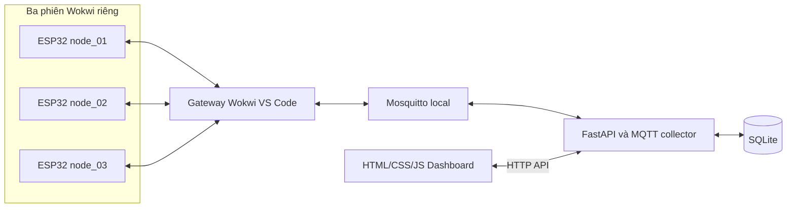

# KẾ HOẠCH THỰC HIỆN ĐỒ ÁN ĐÈN ĐƯỜNG THÔNG MINH

## Thông tin tài liệu

| Thuộc tính               | Nội dung                                                                |
| ------------------------ | ----------------------------------------------------------------------- |
| Đề tài                   | Đèn đường thông minh tự động điều chỉnh độ sáng                         |
| Nhóm                     | Nhóm 7                                                                  |
| Thành viên theo đề cương | Quang Nhật Hưng, Nguyễn Văn Anh Tuấn                                    |
| Phiên bản                | 1.1                                                                     |
| Ngày lập                 | 15/11/2026                                                              |
| Thời gian dự kiến        | 4 tuần, tính từ khi bắt đầu triển khai                                  |
| Hình thức                | Mô phỏng Wokwi trên VS Code; backend, dashboard và broker chạy trên máy |
| Trạng thái               | Kế hoạch; chưa triển khai, chưa nghiệm thu                              |

> Giai đoạn hiện tại chỉ lập và lưu kế hoạch. Mọi cấu hình, giao thức, thuật toán, kiểm thử và lịch trình dưới đây là thiết kế dự kiến cho giai đoạn triển khai sau này. Việc tạo tài liệu này không có nghĩa các chức năng đã được xây dựng hay kiểm chứng.

## Mục lục

1. [Cơ sở và các quyết định đã chốt](#1-cơ-sở-và-các-quyết-định-đã-chốt)
2. [Mục tiêu và tiêu chí nghiệm thu](#2-mục-tiêu-và-tiêu-chí-nghiệm-thu)
3. [Hiện trạng và kiến trúc](#3-hiện-trạng-và-kiến-trúc)
4. [Phần cứng mô phỏng và môi trường](#4-phần-cứng-mô-phỏng-và-môi-trường)
5. [Firmware và thuật toán](#5-firmware-và-thuật-toán)
6. [Giao thức MQTT](#6-giao-thức-mqtt)
7. [Backend, database và API](#7-backend-database-và-api)
8. [Dashboard](#8-dashboard)
9. [Điện năng và thực nghiệm](#9-điện-năng-và-thực-nghiệm)
10. [Tiến độ và phân công](#10-tiến-độ-và-phân-công)
11. [Giao việc cho AI coding agent](#11-giao-việc-cho-ai-coding-agent)
12. [Kiểm thử](#12-kiểm-thử)
13. [Kịch bản demo](#13-kịch-bản-demo)
14. [Rủi ro và phương án dự phòng](#14-rủi-ro-và-phương-án-dự-phòng)
15. [Báo cáo và bộ bàn giao](#15-báo-cáo-và-bộ-bàn-giao)
16. [Giả định và quản lý thay đổi](#16-giả-định-và-quản-lý-thay-đổi)
17. [Tài liệu tham khảo](#17-tài-liệu-tham-khảo)

## 1. Cơ sở và các quyết định đã chốt

### 1.1. Đầu vào

- [Đề cương “Đèn đường thông minh_DeCuongNhom7 (1).docx”](<../Đèn đường thông minh_DeCuongNhom7 (1).docx>).
- [Cuộc trò chuyện Gemini do người dùng cung cấp](https://share.gemini.google/aFrU2sfgj0uK).
- Cấu trúc và cấu hình PlatformIO đã kiểm tra trong thư mục `firmware/`.
- Các lựa chọn được người dùng xác nhận trong quá trình lập kế hoạch.

Đề cương là cơ sở xác định bài toán và yêu cầu. Cuộc trò chuyện Gemini là nguồn tham khảo cách triển khai; những khuyến nghị kỹ thuật cần được đối chiếu với môi trường thực tế và tài liệu chính thức.

### 1.2. Phạm vi đã thống nhất

| Nội dung             | Quyết định                                                       |
| -------------------- | ---------------------------------------------------------------- |
| Thời gian            | 4 tuần                                                           |
| Demo                 | Chỉ Wokwi, không yêu cầu mạch thật                               |
| Quy mô cuối          | 3 node ESP32 độc lập, theo hướng trong cuộc trò chuyện tham khảo |
| Framework            | Arduino trên ESP32 Dev Module                                    |
| Giao tiếp            | MQTT; Mosquitto local                                            |
| Backend              | Python FastAPI                                                   |
| Database             | SQLite                                                           |
| Dashboard            | HTML/CSS/JavaScript thuần; VS Code Live Server                    |
| Chuyển động          | PIR                                                              |
| Người/xe             | PIR + HC-SR04 theo quy ước tạo kịch bản mô phỏng                 |
| Dòng điện và lỗi tải | Biến trở giả lập; không phải đo dòng điện thật                   |
| Bật sáng đón đầu     | Phần mở rộng, không bắt buộc nghiệm thu                          |

### 1.3. Điều chỉnh cần thiết từ tài liệu tham khảo

1. **Ba node chạy ở ba phiên Wokwi riêng.** Không xây dựng kế hoạch dựa trên ba ESP32 cùng chạy trong một `diagram.json`, vì Wokwi chưa hỗ trợ nhiều vi điều khiển trong cùng một mô phỏng. [Nguồn: Wokwi FAQ](https://docs.wokwi.com/faq)
2. **Kết nối local phải được kiểm chứng ngay ngày đầu.** Wokwi VS Code có gateway đi kèm; không mặc định phải sử dụng broker public hoặc tunnel như một số hướng dẫn cho bản web. [Nguồn: cấu hình VS Code](https://docs.wokwi.com/vscode/project-config)
3. **Khoảng cách không chứng minh loại đối tượng.** PIR cung cấp tín hiệu chuyển động, HC-SR04 đo khoảng cách. Quy tắc dưới/trên 100 cm chỉ tạo hai kịch bản người/xe cho demo; không tuyên bố nhận dạng thực tế. [Nguồn: PIR](https://docs.wokwi.com/parts/wokwi-pir-motion-sensor), [HC-SR04](https://docs.wokwi.com/parts/wokwi-hc-sr04)
4. **Không dùng nguyên ngưỡng LDR 300/700 trong đề cương.** ESP32 được cấu hình ADC 12 bit; phải kiểm tra chiều biến thiên và hiệu chỉnh ngưỡng trên mạch mô phỏng. [Nguồn: ADC](https://docs.espressif.com/projects/arduino-esp32/en/latest/api/adc.html)
5. **Điện năng là kết quả mô hình.** Không trình bày số liệu Wokwi như số đo điện năng ngoài thực tế.

## 2. Mục tiêu và tiêu chí nghiệm thu

### 2.1. Mục tiêu tổng thể

Xây dựng mô hình tuyến đường có ba node đèn, tự điều chỉnh ánh sáng theo môi trường và chuyển động. Người vận hành theo dõi trạng thái, nhận cảnh báo, điều khiển từ xa và xem lịch sử trên dashboard.

Luồng thu thập: cảm biến → ESP32 → MQTT → backend → database → dashboard.

Luồng điều khiển: dashboard → API → MQTT → ESP32 → xác nhận → dashboard cập nhật kết quả.

Quyết định AUTO nằm tại node. Backend ngừng hoạt động không được làm dừng khả năng điều chỉnh ánh sáng tại node.

### 2.2. Yêu cầu bắt buộc

| Mã    | Yêu cầu                               | Bằng chứng nghiệm thu                     |
| ----- | ------------------------------------- | ----------------------------------------- |
| FR-01 | Phân biệt ngày, hoàng hôn, đêm từ LDR | Thay đổi ánh sáng và quan sát trạng thái  |
| FR-02 | Tự điều chỉnh mức sáng                | LED và telemetry đúng bảng điều khiển     |
| FR-03 | Phát hiện chuyển động                 | Kích hoạt PIR và quan sát phản ứng        |
| FR-04 | Hai kịch bản người/xe                 | Khoảng cách quy ước dẫn đến 70%/100%      |
| FR-05 | Giữ sáng, giảm sáng dần               | Có hold timer và dimming                  |
| FR-06 | Gửi cảm biến và trạng thái qua MQTT   | Backend nhận, kiểm tra và lưu được        |
| FR-07 | Giám sát ba node                      | Dashboard phân biệt đúng từng node        |
| FR-08 | AUTO/MANUAL từ xa                     | Lệnh đúng đích, có ACK từ node            |
| FR-09 | Phát hiện hở mạch giả lập             | Biến trở về 0 gây cảnh báo                |
| FR-10 | Lưu lịch sử                           | Dữ liệu còn sau restart backend           |
| FR-11 | Thống kê điện năng mô phỏng           | Công thức, biểu đồ, CSV và độ phủ dữ liệu |
| FR-12 | Tiếp tục AUTO khi mất MQTT            | Thay đổi cảm biến vẫn điều khiển LED      |

### 2.3. Chất lượng cần đạt

- Không chờ kết nối Wi-Fi/MQTT bằng vòng lặp vô hạn.
- Không dùng `delay()` dài trong luồng điều khiển.
- Mức sáng chuyển mượt, không nhấp nháy khi LDR sát ngưỡng.
- Một node offline không làm hai node còn lại dừng.
- Tách rõ lỗi tải, mất kết nối và dữ liệu cũ.
- Backend publish lệnh chưa đồng nghĩa node đã áp dụng.
- Mục tiêu cập nhật dashboard: không quá 3 giây ở điều kiện demo bình thường.
- Thay đổi môi trường ổn định trong 5 giây, gồm lọc, xác nhận trạng thái và dimming.
- Chạy ba node liên tục tối thiểu 30 phút trước khi đóng bản nghiệm thu.

Các thời gian trên là mục tiêu cần đo khi triển khai, chưa phải kết quả đã đạt. Timer điều khiển dùng thời gian mô phỏng của node; độ trễ giao diện đo theo thời gian thực của máy trình diễn.

### 2.4. Ngoài phạm vi và phần mở rộng

Ngoài phạm vi bắt buộc: mạch thật, thiết kế nguồn công suất, camera AI, nhận dạng xe thực tế, LoRa, app điện thoại riêng, OTA, bản đồ GIS và triển khai cloud.

Chỉ làm mở rộng sau khi mọi yêu cầu bắt buộc đạt: bật sáng đón đầu, phát lại kịch bản, xuất báo cáo tự động, so sánh nhiều cấu hình hold timer. Nếu không đủ thời gian, giữ các mục này ở phần hướng phát triển.

## 3. Hiện trạng và kiến trúc

### 3.1. Hiện trạng đã quan sát ngày 15/11/2026

| Thành phần                      | Tình trạng                                |
| ------------------------------- | ----------------------------------------- |
| PlatformIO project              | Đã có, cấu trúc đúng                      |
| Board/framework                 | `esp32dev` / Arduino                      |
| PlatformIO IDE/Core             | 3.3.4 / 6.1.19                            |
| Platform Espressif32 cục bộ     | 8.0.0                                     |
| Arduino ESP32 Core cục bộ       | 3.3.12                                    |
| Wokwi extension                 | 4.1.0, đã cài                             |
| Mã nguồn                        | Code mẫu, chưa có chức năng đồ án         |
| Build artifacts                 | Có `.bin` và `.elf`                       |
| `wokwi.toml`, `diagram.json`    | Chưa có trong dự án được kiểm tra         |
| Backend/dashboard               | Chưa có trong thư mục đồ án được kiểm tra |
| Chạy Wokwi, license, MQTT local | Chưa được xác nhận                        |

Lần build kiểm tra trước bị chặn ghi file khóa trong `~/.platformio`. Đây là giới hạn môi trường kiểm tra, chưa đủ kết luận dự án lỗi. Khi triển khai phải build lại trên terminal VS Code; không coi artifact đã có là bằng chứng kiểm thử toàn hệ thống.

### 3.2. Kiến trúc dự kiến



| Thành phần | Trách nhiệm                                         |
| ---------- | --------------------------------------------------- |
| Firmware   | Cảm biến, thuật toán, PWM, lỗi tải, MQTT            |
| Wokwi      | Mạch và đầu vào giả lập                             |
| Mosquitto  | Chuyển tiếp bản tin                                 |
| Backend    | Kiểm tra dữ liệu, lưu trữ, điều phối lệnh, thống kê |
| SQLite     | Telemetry, cảnh báo, lệnh, phiên thực nghiệm        |
| Dashboard  | Giám sát, điều khiển, lịch sử và phân tích          |

### 3.3. Tổ chức dự án khi triển khai

Giữ `firmware/` hiện có. Dự kiến mở rộng thư mục cha `DoAn/` thành dự án tổng; không di chuyển hay tạo lại firmware chỉ để đổi tên thư mục.

```text
DoAn/
├── README.md
├── AGENTS.md
├── firmware/
│   ├── platformio.ini
│   ├── include/
│   ├── src/
│   ├── lib/
│   ├── test/
│   └── simulations/
│       ├── node_01/
│       ├── node_02/
│       └── node_03/
├── backend/
├── dashboard/
├── infra/
├── scripts/
└── docs/
    ├── architecture.md
    ├── protocol.md
    ├── test-plan.md
    ├── demo-runbook.md
    └── experiments/
```

Mỗi thư mục mô phỏng có `diagram.json`, `wokwi.toml`, thư mục build riêng và nhãn node rõ ràng. Script chuẩn bị demo sao chép `.bin`/`.elf` tương ứng từ kết quả PlatformIO; không nhân bản mã nguồn firmware.

Không commit cache, `.venv`, `node_modules`, build hoặc database chạy thử. Bộ dữ liệu nghiệm thu được xuất riêng vào `docs/experiments/`. Giữ nguyên các thư mục hướng dẫn có sẵn; chỉ bổ sung hướng dẫn dự án ở vị trí ghi được khi đến giai đoạn triển khai.

## 4. Phần cứng mô phỏng và môi trường

### 4.1. Pin map một node

| Thành phần   | Linh kiện Wokwi              | Kết nối dự kiến              |
| ------------ | ---------------------------- | ---------------------------- |
| ESP32        | `board-esp32-devkit-c-v4`    | Bộ điều khiển                |
| LDR          | `wokwi-photoresistor-sensor` | AO → GPIO34                  |
| PIR          | `wokwi-pir-motion-sensor`    | OUT → GPIO27                 |
| HC-SR04      | `wokwi-hc-sr04`              | TRIG → GPIO18, ECHO → GPIO19 |
| Biến trở tải | `wokwi-potentiometer`        | SIG → GPIO35                 |
| LED vàng     | `wokwi-led`                  | PWM GPIO26                   |
| Điện trở     | `wokwi-resistor`             | 220 Ω nối tiếp LED           |

Chọn GPIO18/19 cho siêu âm thay GPIO12 trong hướng dẫn tham khảo để tránh dùng chân cấu hình khởi động cho tín hiệu này. LDR và biến trở dùng nguồn 3,3 V; HC-SR04 dùng 5 V trong mô phỏng; các linh kiện có GND chung.

Hai đầu vào analog dùng ADC1. Nhãn dây và ID linh kiện nhất quán để tái sử dụng sơ đồ cho các node. Pin map phải được kiểm tra theo đúng tên chân của board Wokwi, không sao chép tên chân từ loại board khác.

### 4.2. Quy ước giả lập tải

- Biến trở tối đa: tải bình thường; về 0: hở mạch.
- LED thể hiện mức PWM được yêu cầu, không phải một phép đo tải.
- Biến trở là tín hiệu giả lập độc lập, nên LED không nhất thiết tự tắt khi biến trở về 0. Dashboard phải phân biệt lệnh sáng và lỗi tải.
- Không sử dụng sơ đồ mô phỏng như thiết kế đấu điện cho đèn công suất thật.

### 4.3. Build và phụ thuộc

- Giữ environment `esp32dev` làm `node_01`; thêm `node_02`, `node_03`.
- Cấu hình chung board, framework và thư viện; khác `NODE_ID`, client ID.
- Dùng API PWM Arduino Core 3.x: `ledcAttach()` và `ledcWrite()`; PWM dự kiến 5 kHz, 8 bit. [Nguồn: LEDC](https://docs.espressif.com/projects/arduino-esp32/en/latest/api/ledc.html)
- Sau smoke test, khóa phiên bản platform/framework và phụ thuộc đã build thành công; ghi vào README.
- Backend dùng môi trường Python riêng; dashboard có lockfile; không nâng cấp toolchain giữa đợt tích hợp và bảo vệ.

### 4.4. Setup Wokwi theo trình tự

1. Xác nhận PlatformIO và Wokwi extension đã hoạt động.
2. Mở Command Palette, dùng lệnh yêu cầu license Wokwi và hoàn tất đăng nhập/xác nhận trên trình duyệt; kiểm tra quyền sử dụng thực tế. [Nguồn: Getting Started](https://docs.wokwi.com/vscode/getting-started)
3. Build firmware mẫu; kiểm tra đường dẫn `.bin`/`.elf`.
4. Chuẩn bị một cấu hình mô phỏng, trỏ `firmware` tới `build/firmware.bin`, `elf` tới `build/firmware.elf`; version cấu hình bằng 1.
5. Đặt `wokwi.toml` cạnh `diagram.json`, mở đúng thư mục mô phỏng trong VS Code.
6. Chạy một ESP32, xác nhận Serial và điều khiển LED.
7. Kiểm tra MQTT local trước khi tích hợp nhiều cảm biến.
8. Khi một node đạt, mới nhân cấu hình thành ba phiên và đặt ID riêng.

Wokwi chạy firmware đã build; phải build khi thay mã nguồn. [Nguồn: PlatformIO trên Wokwi](https://docs.wokwi.com/vscode/platformio)

### 4.5. Kết nối mạng dự kiến

| Client                | Broker                                         |
| --------------------- | ---------------------------------------------- |
| ESP32 trong Wokwi     | `host.wokwi.internal:1883` qua gateway VS Code |
| Backend               | `127.0.0.1:1883`                               |
| Công cụ kiểm tra MQTT | `127.0.0.1:1883`                               |

Firmware dùng Wi-Fi mô phỏng `Wokwi-GUEST`. Mosquitto chạy bằng cấu hình của dự án, listener trên loopback; cho phép client local không xác thực trong demo một máy. Không công khai listener ra Internet. Chính sách listener phải được khai báo rõ, không dựa vào mặc định chưa kiểm tra. [Nguồn: Mosquitto authentication](https://mosquitto.org/documentation/authentication-methods/)

## 5. Firmware và thuật toán

### 5.1. Phân tách chức năng

| Module             | Nội dung                                   |
| ------------------ | ------------------------------------------ |
| SensorReader       | Lấy mẫu, lọc, kết quả đo và timeout        |
| LightingController | Môi trường, chuyển động, mức sáng mục tiêu |
| DimmingController  | PWM tiến tới mục tiêu                      |
| FaultDetector      | Phát hiện/phục hồi lỗi tải                 |
| Connectivity       | Wi-Fi, MQTT, reconnect                     |
| Telemetry/Command  | JSON, kiểm tra lệnh, ACK                   |

Tách logic khỏi API phần cứng để kiểm thử bằng đầu vào và thời gian giả lập. Giữ `main.cpp` ở vai trò điều phối.

### 5.2. Trạng thái độc lập

| Chiều trạng thái  | Giá trị                            |
| ----------------- | ---------------------------------- |
| Chế độ            | AUTO, MANUAL                       |
| Môi trường        | UNKNOWN, DAY, TWILIGHT, NIGHT      |
| Đối tượng giả lập | NONE, PEDESTRIAN, VEHICLE, UNKNOWN |
| Lỗi tải           | OK, OPEN_LOAD                      |
| Kết nối           | Trạng thái Wi-Fi/MQTT riêng        |
| Độ sáng           | Mục tiêu và đang áp dụng           |

Không ép tất cả thông tin vào một biến trạng thái. Một node có thể vừa MANUAL, vừa NIGHT, vừa OPEN_LOAD.

### 5.3. Chu kỳ xử lý

| Công việc                           |                         Chu kỳ |
| ----------------------------------- | -----------------------------: |
| Đọc PIR, dimming                    |                          20 ms |
| Lấy mẫu LDR, biến trở, đánh giá lỗi |                         100 ms |
| Đo siêu âm                          |                         200 ms |
| Log Serial tổng hợp                 |                         1 giây |
| Telemetry định kỳ                   |                         2 giây |
| Telemetry khi trạng thái đổi        | Gửi sớm, tối đa 5 bản tin/giây |

Đo siêu âm timeout tối đa 30 ms. Xung kích microsecond được phép; không chờ nhiều giây cho cảm biến/kết nối. Kiểm tra giá trị trả về của thao tác PWM và publish.

### 5.4. LDR và môi trường

ADC 12 bit, 0–4095. Trên mô hình dự kiến, ánh sáng tăng làm ADC giảm; phải xác nhận bằng thanh trượt Lux và Serial. Dashboard hiển thị ADC, không gắn đơn vị Lux nếu chưa có phép quy đổi. [Nguồn: mô hình LDR](https://docs.wokwi.com/parts/wokwi-photoresistor-sensor)

| ADC đã lọc lúc khởi tạo | Môi trường |
| ----------------------: | ---------- |
|                  < 1200 | DAY        |
|               1200–2600 | TWILIGHT   |
|                  > 2600 | NIGHT      |

Trung bình trượt 5 mẫu, hysteresis ±100 ADC, xác nhận điều kiện mới liên tục 1 giây. Cho phép nhảy trực tiếp DAY ↔ NIGHT khi vượt rõ cả hai vùng. Khi mới boot chưa đủ dữ liệu: UNKNOWN, mục tiêu tạm 50%.

Chuyển vùng dự kiến sau khi có trạng thái:

| Trạng thái hiện tại | Điều kiện đổi                                        |
| ------------------- | ---------------------------------------------------- |
| DAY                 | ADC ≥ 2700 → NIGHT; nếu không, ADC ≥ 1300 → TWILIGHT |
| TWILIGHT            | ADC ≤ 1100 → DAY; ADC ≥ 2700 → NIGHT                 |
| NIGHT               | ADC ≤ 1100 → DAY; nếu không, ADC ≤ 2500 → TWILIGHT   |

Mọi ứng viên chuyển trạng thái phải ổn định 1 giây. Các ngưỡng là giá trị khởi đầu để hiệu chỉnh, không phải tiêu chuẩn chiếu sáng đô thị.

### 5.5. Bảng mức sáng AUTO

| Điều kiện                                         |                Mục tiêu |
| ------------------------------------------------- | ----------------------: |
| DAY                                               |                      0% |
| TWILIGHT, không chuyển động                       |                     50% |
| NIGHT, không chuyển động                          |                     25% |
| TWILIGHT/NIGHT, người giả lập                     |                     70% |
| TWILIGHT/NIGHT, xe giả lập                        |                    100% |
| TWILIGHT/NIGHT, chuyển động nhưng khoảng cách lỗi | 100%, đối tượng UNKNOWN |

DAY giữ 0% trong AUTO, kể cả có chuyển động. MANUAL được ưu tiên so với bảng AUTO.

### 5.6. Người/xe, giữ sáng và dimming

- Chỉ phân loại khi PIR HIGH: khoảng cách hợp lệ dưới 100 cm là VEHICLE; từ 100 cm là PEDESTRIAN; timeout là UNKNOWN.
- PIR LOW: NONE; khoảng cách gần một mình không kích hoạt xe.
- Giữ mức sáng tăng trong 5 giây từ lần cuối PIR còn HIGH.
- Sự kiện mới làm mới thời gian giữ; giữ mức cao nhất còn hiệu lực.
- Hết thời gian giữ, trở về mức nền môi trường hiện tại.
- Chuyển DAY trong AUTO hủy giữ sáng và giảm về 0%.
- Dimming tối đa 2 điểm phần trăm/20 ms, dừng chính xác tại mục tiêu, kể cả mục tiêu lẻ như 25%.
- PIR mô phỏng đặt `delayTime = 1` giây; thời gian HIGH của cảm biến và hold 5 giây của firmware là hai khoảng khác nhau.

### 5.7. MANUAL và mất kết nối

- Độ sáng MANUAL là số nguyên 0–100%; cho phép sáng cả ban ngày.
- Mỗi lệnh có hiệu lực MANUAL 60 giây; lệnh mới làm mới thời hạn.
- Hết hạn hoặc firmware xác định MQTT đã ngắt: trở lại AUTO.
- Boot luôn bắt đầu AUTO; reconnect không phục hồi lệnh MANUAL cũ.
- Lệnh AUTO đánh giá ngay cảm biến hiện tại; không tái dùng một hold timer cũ đã bị hủy.
- Nếu backend dừng nhưng broker vẫn nối, MANUAL vẫn hết hạn theo bộ đếm tại node.

### 5.8. Tải và lỗi hở mạch

Thông số mô hình mỗi đèn: 12 V, 24 W, dòng định mức 2 A.

```text
load_factor = current_adc / 4095
I_expected = I_rated × brightness_applied / 100
I_sim = I_expected × load_factor
```

OPEN_LOAD được xác nhận khi độ sáng áp dụng ≥20%, đã ổn định tối thiểu 1 giây và dòng mô phỏng dưới 10% dòng kỳ vọng liên tục 2 giây. Bộ đếm xác nhận được đặt lại nếu điều kiện không còn hợp lệ.

Phục hồi khi dòng đạt ít nhất 20% dòng kỳ vọng liên tục 3 giây, với đèn ≥20% và mức điều khiển ổn định. Đèn tắt không tạo lỗi mới và không tự xóa lỗi cũ. AUTO/MANUAL không xóa lỗi bằng thao tác đổi chế độ. Không tự tắt PWM chỉ vì OPEN_LOAD; phiên bản này phục vụ giám sát và không tuyên bố phát hiện ngắn mạch/quá dòng.

## 6. Giao thức MQTT

### 6.1. Topic và thư viện

Prefix `huit/nhom7/smartlight/v1`; node ID cố định `node_01`, `node_02`, `node_03`.

| Topic con                | Chiều          | Retain |
| ------------------------ | -------------- | ------ |
| `{node_id}/telemetry`    | Node → backend | Không  |
| `{node_id}/availability` | Node → backend | Có     |
| `{node_id}/command`      | Backend → node | Không  |
| `{node_id}/ack`          | Node → backend | Không  |

Dự kiến PubSubClient 2.8, ArduinoJson 7; khóa bản vá sau smoke test. PubSubClient chỉ publish QoS 0, buffer mặc định nhỏ; tăng buffer lên 2048 byte, kiểm tra tổng kích thước topic/payload. Telemetry/ACK dùng QoS 0; backend gửi command QoS 1, node subscribe QoS 1. Không giả định ACK có bảo đảm QoS 1. [Nguồn: PubSubClient](https://github.com/knolleary/pubsubclient)

Dùng clean session; command không retained và không xếp hàng cho node offline. Client ID riêng từng node; không dùng mặc định trùng nhau.

### 6.2. Telemetry v1 dự kiến

Đây là hợp đồng dữ liệu cho giai đoạn triển khai, chưa phải bản tin từ hệ thống đang chạy.

```json
{
  "schema_version": 1,
  "node_id": "node_01",
  "boot_id": "b7e28a10",
  "seq": 120,
  "uptime_ms": 240000,
  "mode": "AUTO",
  "environment": "NIGHT",
  "ldr_adc": 3100,
  "motion": "VEHICLE",
  "distance_cm": 60.0,
  "brightness_target": 100,
  "brightness_applied": 100,
  "current_adc": 4095,
  "current_ma_sim": 2000.0,
  "power_sim_w": 24.0,
  "faults": []
}
```

- `boot_id` mới mỗi lần boot, `seq` tăng trong phiên đó; uptime dùng bộ đếm đơn điệu 64 bit.
- Khoảng cách lỗi là `null`; lỗi tải biểu diễn bằng `faults: ["OPEN_LOAD"]`.
- Backend thêm thời điểm nhận UTC; node không cần giờ Internet.
- ID trong topic phải khớp payload; chỉ tiếp nhận ba ID đã đăng ký.
- Trùng `(node_id, boot_id, seq)` không lưu/tính điện năng lần hai.
- Bản tin đến muộn không ghi đè trạng thái mới hơn; mẫu không đúng thứ tự không dùng tích phân điện năng.
- Backend đánh dấu chất lượng dữ liệu, không biến telemetry sai thành giá trị 0.

### 6.3. Lệnh và xác nhận

API nhận AUTO hoặc MANUAL kèm độ sáng. Backend bổ sung ID lệnh duy nhất, boot ID đích và deadline theo uptime của node.

| Nội dung             | Quy tắc                                                                     |
| -------------------- | --------------------------------------------------------------------------- |
| Điều kiện gửi        | Broker nối; telemetry mới trong 3 giây                                      |
| Hạn áp dụng          | Uptime mới nhất + 5 giây                                                    |
| Sai boot/quá hạn     | Node từ chối                                                                |
| Lệnh chờ             | Tối đa một lệnh/node                                                        |
| Retry                | Sau 2 giây chưa ACK, gửi lại tối đa một lần cùng ID                         |
| Timeout backend      | 10 giây chưa xác nhận                                                       |
| Chống trùng tại node | Nhớ 32 ID gần nhất trong RAM; lặp lại kết quả, không gia hạn MANUAL lần hai |

ACK chứa `schema_version`, `node_id`, `boot_id`, `command_id`, kết quả APPLIED/REJECTED và lý do nếu bị từ chối. APPLIED nghĩa chế độ/mục tiêu đã được chấp nhận; PWM có thể đang dimming. Dashboard dùng telemetry để hiển thị độ sáng đang áp dụng.

Lệnh APPLIED, REJECTED hoặc TIMEOUT là kết quả cuối. ACK muộn sau TIMEOUT được ghi nhận để chẩn đoán nhưng không tự chuyển giao diện sang thành công; trạng thái thực tế vẫn lấy từ telemetry.

### 6.4. Reconnect và availability

- Retry Wi-Fi/MQTT theo 1, 2, 4, 8 giây, tối đa 10 giây; không chờ vô hạn.
- LWT báo offline; reconnect subscribe lại, gửi availability và telemetry mới.
- Backend đánh dấu offline sau 10 giây không có telemetry hợp lệ hoặc khi nhận LWT.
- Availability retained không đủ xác nhận online; cần telemetry mới.
- Backend restart chờ dữ liệu mới trước khi báo online.
- Broker mất kết nối khiến dashboard báo hệ thống suy giảm, không coi các giá trị cũ là mới.
- Không có bộ đệm lịch sử offline trong bản đầu; phải biểu diễn khoảng thiếu dữ liệu.

## 7. Backend, database và API

### 7.1. Công nghệ và xử lý

FastAPI, Pydantic, Paho MQTT, SQLite WAL, Pytest. Chạy một backend worker để tránh collector trùng. Lifecycle ứng dụng mở/đóng MQTT và database; callback MQTT đưa dữ liệu vào hàng đợi, một luồng xử lý có kiểm soát kiểm tra và ghi dữ liệu. Không ghi database tùy tiện từ nhiều callback.

Database có script khởi tạo và schema version; restart ứng dụng không xóa dữ liệu. Lỗi database phải làm health báo lỗi và ngăn nhận lệnh không thể ghi nhận đầy đủ.

### 7.2. Nhóm dữ liệu

| Bảng/nhóm   | Nội dung                                                      |
| ----------- | ------------------------------------------------------------- |
| nodes       | Định danh, trạng thái mới nhất, boot, last_seen               |
| telemetry   | seq, uptime, cảm biến, chế độ, độ sáng, công suất, chất lượng |
| alerts      | Loại lỗi, bắt đầu/kết thúc, node                              |
| commands    | Nội dung, gửi/retry, ACK, kết quả cuối                        |
| experiments | Tên phiên, cấu hình, bắt đầu/kết thúc và ghi chú              |

Ràng buộc duy nhất cho telemetry theo node/boot/seq. Chỉ mục theo node và thời điểm nhận. Mỗi phép cập nhật trạng thái, telemetry và sự kiện liên quan được ghi trong transaction phù hợp.

### 7.3. API dự kiến

| Endpoint                               | Chức năng                           |
| -------------------------------------- | ----------------------------------- |
| GET `/api/health`                      | Backend, broker, database           |
| GET `/api/nodes`                       | Ba node và trạng thái mới nhất      |
| GET `/api/nodes/{node_id}/history`     | Lịch sử theo khoảng thời gian       |
| POST `/api/nodes/{node_id}/commands`   | Gửi lệnh                            |
| GET `/api/commands/{command_id}`       | Kết quả lệnh                        |
| GET `/api/alerts`                      | Cảnh báo và lịch sử                 |
| GET `/api/stats`                       | Điện năng, baseline, độ phủ dữ liệu |
| GET `/api/experiments`                 | Danh sách phiên, có phân trang      |
| GET `/api/experiments/{id}`            | Chi tiết cấu hình và thời gian phiên |
| POST `/api/experiments`                | Bắt đầu phiên thực nghiệm           |
| POST `/api/experiments/{id}/stop`      | Kết thúc phiên                      |
| GET `/api/experiments/{id}/export.csv` | Xuất CSV                            |

History/stats dùng `from`, `to` ISO 8601 UTC; mặc định một giờ gần nhất. History có phân trang tối đa 1000 bản ghi/lần; mỗi mẫu trả `continuity` để biểu đồ không nối qua ranh giới run/session/barrier. Danh sách phiên mặc định100, tối đa1000 mục/lần, offset không âm, mới nhất trước. Dashboard chuyển UTC sang giờ Việt Nam. Một thời điểm chỉ có một phiên thực nghiệm đang mở; thao tác stop lặp lại trả phiên đã kết thúc.

Đầu vào command: `{"mode":"AUTO"}` hoặc `{"mode":"MANUAL","brightness":80}`. AUTO không chấp nhận brightness; MANUAL bắt buộc số nguyên 0–100; từ chối trường không thuộc hợp đồng.

| Mã HTTP | Ý nghĩa                                       |
| ------- | --------------------------------------------- |
| 202     | Đã tiếp nhận lệnh, chưa phải node đã áp dụng  |
| 404     | Tài nguyên không tồn tại                      |
| 409     | Offline, dữ liệu quá cũ hoặc đang có lệnh chờ |
| 422     | Dữ liệu không hợp lệ                          |
| 503     | Broker/database không sẵn sàng                |

CORS chỉ cho origin dashboard local đã cấu hình. Chưa xây hệ thống tài khoản trong bản demo một máy.

### 7.4. Cảnh báo

Tạo một sự kiện khi bình thường → lỗi, không lặp ở mỗi telemetry. Phục hồi đóng sự kiện bằng thời điểm kết thúc. Offline và lỗi tải tách riêng. Nếu node đã có lỗi rồi mất kết nối, không tự coi là phục hồi; giữ lỗi cuối cùng kèm nhãn dữ liệu cũ.

## 8. Dashboard

### 8.1. Màn hình

- **Tổng quan:** sức khỏe backend/broker, số node online, lỗi tải, điện năng mô phỏng và phiên đo.
- **Tuyến đường:** ba cột đèn có ID rõ ràng, độ sáng thể hiện theo PWM đang áp dụng; không cần bản đồ địa lý.
- **Chi tiết node:** mode, môi trường, ADC, chuyển động/đối tượng giả lập, khoảng cách, mục tiêu/PWM, dòng/công suất mô phỏng, lỗi và last_seen.
- **Lịch sử:** độ sáng/công suất theo thời gian, cảnh báo, thống kê baseline, chọn phiên và xuất CSV.

### 8.2. Điều khiển

AUTO/MANUAL riêng cho từng node. Slider chỉ hoạt động khi chọn MANUAL; có nút Áp dụng, không publish liên tục theo từng pixel kéo. Hiển thị đang gửi, xác nhận, từ chối, timeout. Khóa thao tác khi offline, API lỗi hoặc đang có lệnh chờ; giải thích lý do ngay tại điều khiển. Hiển thị MANUAL tự hết hạn sau 60 giây.

### 8.3. Cập nhật và dữ liệu cũ

Polling trạng thái mỗi giây, thống kê/cảnh báo mỗi 5 giây; không thêm WebSocket trong bản đầu. Khi API lỗi, giữ dữ liệu cuối nhưng đánh dấu cũ, khóa điều khiển và tiếp tục thử kết nối. Biểu đồ có khoảng trống khi thiếu dữ liệu. Không dùng dữ liệu fixture để lấp khoảng trống live.

## 9. Điện năng và thực nghiệm

### 9.1. Công thức

```text
P_sim = V_nominal × I_sim
ΔE_Wh = (P_previous + P_current) / 2 × Δt_seconds / 3600
```

Tải bình thường có `P_sim ≈ 24 × brightness_applied / 100`. Đây là mô hình tuyến tính phục vụ đồ án, không khẳng định đèn thương mại có quan hệ công suất–độ sáng tuyến tính.

Dùng chênh lệch uptime node cho Δt. Chỉ tích phân hai mẫu cùng boot, đúng thứ tự và `0 < Δt ≤ 6 giây`; không nối qua restart hoặc khoảng thiếu dài. Thời điểm nhận UTC dùng gán khoảng hiển thị/truy vấn. Với phiên đo, chỉ nhận đoạn có hai mẫu nằm trong phiên, tránh tính vượt ranh giới.

### 9.2. Baseline và độ phủ

Baseline: DAY 0 W; TWILIGHT/NIGHT 24 W/node. So sánh cùng node, cùng khoảng thời gian hợp lệ; không dùng baseline sáng 24/24 giờ để làm tăng tỷ lệ tiết kiệm.

```text
saving_percent = (E_baseline - E_smart) / E_baseline × 100
```

Baseline bằng 0 trả `null`. Thống kê phải công bố thời lượng hợp lệ, thiếu dữ liệu, khoảng bị loại và độ phủ. Tổng năng lượng thu thập được của toàn bộ chế độ được trình bày riêng với so sánh hiệu quả AUTO.

So sánh AUTO loại khoảng MANUAL, fault, xác minh/phục hồi fault, hiệu chỉnh biến trở với load_factor <0,95, offline và dữ liệu sai. Loại một đoạn nếu bất kỳ đầu mút nào không đủ điều kiện; không tính ngược qua thời điểm trạng thái đổi. Giữ dữ liệu gốc và lý do loại mẫu.

### 9.3. Phiên thực nghiệm

| Mã    | Nội dung                       | Thời lượng |
| ----- | ------------------------------ | ---------: |
| EX-01 | Ban ngày, thay đổi chuyển động |     5 phút |
| EX-02 | Đêm không chuyển động          |    10 phút |
| EX-03 | Đêm có người giả lập định kỳ   |    10 phút |
| EX-04 | Đêm có xe giả lập định kỳ      |    10 phút |
| EX-05 | Hỗn hợp ba node                |    15 phút |
| EX-06 | Lỗi tải và phục hồi            |     5 phút |
| EX-07 | Mất broker, reconnect          |     5 phút |

EX-02 đến EX-05 lặp ba lần cùng lịch tác động. Kịch bản định kỳ dùng một lần kích PIR mỗi 30 giây; EX-03 đặt 150 cm, EX-04 đặt 50 cm. EX-05 ghi trước bảng thao tác theo node và mốc thời gian, tái dùng đúng bảng cho mọi lượt. Các phiên còn lại kiểm tra chức năng và giới hạn.

Mỗi phiên lưu mã phiên bản, cấu hình, nhật ký thao tác, CSV, ảnh, điện năng, baseline, độ phủ và nhận xét. Báo cáo trung bình, khoảng biến thiên giữa các lượt; ghi rõ số mẫu bị loại.

Không đặt trước một tỷ lệ tiết kiệm bắt buộc. Ở tải bình thường, mức 25% lý tưởng cho khoảng tiết kiệm 75% so với nền 100%; chỉ dùng kiểm tra công thức. Các kết quả số chưa được thực nghiệm không được điền như thành tích đã đạt.

## 10. Tiến độ và phân công

### 10.1. Nguồn lực dự kiến

Hai thành viên, giả định 15 giờ/người/tuần, tổng 120 giờ công. Ngày bắt đầu và hạn nộp chính thức chưa được cung cấp; dùng ngày làm việc D1–D20. Đây là giả định nguồn lực, không phải thông tin đã được nhóm xác nhận.

| Thành viên | Trách nhiệm dự kiến                               |
| ---------- | ------------------------------------------------- |
| Hưng       | Firmware, Wokwi, MQTT, tích hợp                   |
| Tuấn       | Backend, database, dashboard                      |
| Cả hai     | Giao thức, kiểm thử, thực nghiệm, báo cáo, bảo vệ |

Phân công là mặc định để lập lịch; hai người đều phải tự chạy được hệ thống và giải thích toàn bộ luồng.

### 10.2. Gói công việc

| Gói  | Công việc                        | Giờ công | Điều kiện hoàn thành                       |
| ---- | -------------------------------- | -------: | ------------------------------------------ |
| P0   | Môi trường, kiến trúc, giao thức |        6 | Build, license, MQTT local xác nhận        |
| P1   | Mạch và đọc cảm biến một node    |       14 | Serial đúng, PWM đúng, pin map rõ          |
| P2   | AUTO/MANUAL, hold, dimming, lỗi  |       20 | Kiểm thử logic một node đạt                |
| P3   | MQTT, ACK, reconnect             |       16 | Giao tiếp hai chiều, phục hồi đúng         |
| P4   | Backend, database, API           |       20 | Lưu/truy vấn/lệnh/thống kê hoạt động       |
| P5   | Dashboard                        |       16 | Giám sát, lệnh và dữ liệu cũ rõ ràng       |
| P6   | Ba node, tích hợp                |       10 | Đúng đích, không trùng ID, ổn định 30 phút |
| P7   | Thực nghiệm, báo cáo, video      |       10 | Dữ liệu, phân tích và bàn giao             |
| P8   | Dự phòng                         |        8 | Sửa lỗi, diễn tập, đóng phiên bản          |
| Tổng |                                  |      120 |                                            |

Báo cáo được viết dần từ P0; P7 là tổng hợp cuối. Backend/dashboard có thể làm bằng fixture sau khi chốt schema, nhưng phải tách fixture khỏi dữ liệu live.

### 10.3. Tuần 1 — Môi trường và một node

- **D1:** kiểm tra build, license, một ESP32 Wokwi, Mosquitto và publish/subscribe local; chốt pin map và giao thức v1.
- **D2–D3:** dựng mạch, đọc từng cảm biến, kiểm tra chiều ADC, PWM 0/25/50/70/100%; ghi cách thao tác mô phỏng.
- **D4–D5:** logic môi trường, mức sáng, hysteresis, hold và dimming; kiểm thử đầu vào cố định; phác thảo database/API.
- **M1:** một node tự điều chỉnh được; kết nối local đã có bằng chứng. Không chuyển sang tích hợp dựa trên giả định kết nối chưa kiểm tra.

### 10.4. Tuần 2 — Firmware và MQTT hai chiều

- **D6–D7:** người/xe giả lập, lỗi/phục hồi, MANUAL và timeout; kiểm thử ưu tiên, thời gian.
- **D8–D9:** telemetry, command, ACK, availability, chống lệnh trùng/quá hạn; mất broker/reconnect; collector và database cơ bản.
- **D10:** API trạng thái, lưu lịch sử qua restart; hoàn thiện protocol và ví dụ payload.
- **M2:** một node đầy đủ; API điều khiển có ACK; backend lưu dữ liệu.

### 10.5. Tuần 3 — Backend, dashboard và ba node

- **D11–D12:** API command/alerts/history/stats; điện năng và phiên đo; kiểm thử deduplicate/thiếu dữ liệu; giao diện tuyến đường.
- **D13–D14:** AUTO/MANUAL, biểu đồ, offline; build ba cấu hình và chuẩn bị script mô phỏng.
- **D15:** chạy đồng thời ba node, kiểm tra đúng đích, tích hợp toàn hệ thống.
- **M3:** demo xuyên suốt ba node, không còn lỗi chặn. Chỉ cân nhắc mở rộng nếu bản cốt lõi đã đạt.

### 10.6. Tuần 4 — Kiểm chứng và bàn giao

- **D16–D17:** ca tích hợp, 30 phút ổn định, thực nghiệm và export.
- **D18:** phân tích, biểu đồ, giới hạn; ghi video dự phòng.
- **D19:** báo cáo, slide, README, runbook; diễn tập từ trạng thái tắt toàn bộ dịch vụ.
- **D20:** dự phòng sửa lỗi, smoke test lại, đóng bản nghiệm thu và sao lưu; ngừng thêm tính năng.
- **M4:** khởi động lại demo theo hướng dẫn và có đủ bộ bàn giao.

Phụ thuộc chính: P0 → P1 → P2 → P3 → tích hợp P4/P5 → P6 → P7. Lịch các gói có thể giao nhau theo hai người; tổng giờ công không phải thời gian chờ tuần tự.

## 11. Giao việc cho AI coding agent

Phần này là kế hoạch sử dụng agent trong giai đoạn sau; hiện tại không gọi agent triển khai.

### 11.1. Quy tắc

- Đọc kế hoạch, hướng dẫn dự án và protocol trước khi sửa.
- Chia gói nhỏ, có đầu vào/đầu ra và điểm kiểm tra.
- Không tự thay stack, mở rộng phạm vi hoặc đổi schema một phía.
- Không nhân bản mã nguồn cho mỗi node; không ghi đè hướng dẫn có sẵn.
- Không coi build thành công là mô phỏng đã chạy đúng.
- Phân biệt fixture, dữ liệu mô phỏng live và thực nghiệm.
- Kết thúc gói bằng thay đổi, cách kiểm tra, kết quả và phần chưa xác minh.
- Không deploy cloud, đăng ký dịch vụ hay mua linh kiện trong các gói này.

### 11.2. Chuỗi giao việc

| Gói | Đầu vào             | Đầu ra                                | Điểm kiểm tra                      |
| --- | ------------------- | ------------------------------------- | ---------------------------------- |
| A0  | Kế hoạch, repo      | Cấu hình cố định, protocol, hướng dẫn | Review schema và build             |
| A1  | Pin map             | Mạch một node, Serial, PWM            | Xác minh trong Wokwi               |
| A2  | Bảng thuật toán     | Logic, timer, lỗi, MANUAL             | Kiểm thử logic đạt                 |
| A3  | MQTT v1             | Telemetry, command, ACK, reconnect    | Điều khiển một node đúng           |
| A4  | Protocol, fixture   | Collector, DB, API, năng lượng        | Kiểm thử backend đạt               |
| A5  | API đã chốt         | Dashboard                             | Giám sát, thao tác, lỗi đúng       |
| A6  | Một node hoàn chỉnh | Ba cấu hình mô phỏng                  | Đúng ID, đúng đích, chạy đồng thời |
| A7  | Bản tích hợp        | Kiểm thử, export, runbook, tài liệu   | Bộ bàn giao có bằng chứng          |

### 11.3. Mẫu yêu cầu

> Đọc kế hoạch đồ án, hướng dẫn dự án và giao thức MQTT/API. Chỉ thực hiện gói [Ax]. Đầu vào: [...]. Đầu ra bắt buộc: [...]. Tiêu chí nghiệm thu: [...]. Giữ các quyết định đã chốt. Báo mâu thuẫn trước khi đổi giao thức. Chạy kiểm tra phù hợp, ghi bằng chứng và phần chưa xác minh. Không tự thực hiện gói tiếp theo.

AI hỗ trợ lập trình và tài liệu; nhóm chịu trách nhiệm review, chạy Wokwi, hiểu thuật toán và trả lời bảo vệ.

## 12. Kiểm thử

### 12.1. Các tầng

- Logic firmware: PlatformIO native, dữ liệu và clock giả lập; không phải chờ thật cho timer.
- Firmware đích: build cả ba environment, kiểm tra kích thước và lỗi biên dịch.
- Mô phỏng: kiểm chứng pin, ADC, PWM và cảm biến trong Wokwi.
- Backend: Pytest, SQLite tạm, fixture MQTT và kiểm thử API.
- Dashboard: luồng thao tác, trạng thái lệnh, mất API và dữ liệu cũ.
- Tích hợp: broker thật local, ba phiên Wokwi, backend/dashboard cùng chạy.

### 12.2. Ma trận chức năng

| Mã    | Tình huống                       | Kết quả mong đợi                                    |
| ----- | -------------------------------- | --------------------------------------------------- |
| TC-01 | Ngày, không chuyển động          | AUTO 0%                                             |
| TC-02 | Ngày, có chuyển động             | Vẫn 0%                                              |
| TC-03 | Hoàng hôn, không chuyển động     | 50%                                                 |
| TC-04 | Đêm, không chuyển động           | 25%                                                 |
| TC-05 | Đêm, PIR HIGH, 150 cm            | 70%, người giả lập                                  |
| TC-06 | Đêm, PIR HIGH, 50 cm             | 100%, xe giả lập                                    |
| TC-07 | PIR LOW, khoảng cách gần         | Không kích hoạt xe                                  |
| TC-08 | PIR HIGH, siêu âm timeout        | 100%, UNKNOWN                                       |
| TC-09 | PIR hết HIGH                     | Giữ 5 giây rồi giảm                                 |
| TC-10 | Xe rồi người trong hold          | Không giảm sớm từ 100%                              |
| TC-11 | LDR dao động sát ngưỡng          | Không đổi trạng thái liên tục                       |
| TC-12 | MANUAL 80% ban ngày              | Chấp nhận và dimming tới 80%                        |
| TC-13 | MANUAL hết 60 giây               | AUTO                                                |
| TC-14 | Tải về 0 khi sáng ổn định        | OPEN_LOAD sau xác nhận                              |
| TC-15 | Tải về 0 khi tắt                 | Không tạo lỗi mới                                   |
| TC-16 | Tải được khôi phục               | Đóng lỗi sau 3 giây hợp lệ                          |
| TC-17 | Gửi lệnh node_02                 | Không đổi node_01/03                                |
| TC-18 | Lệnh trùng ID                    | Không áp dụng/gia hạn hai lần                       |
| TC-19 | Sai boot/quá hạn                 | Từ chối, có lý do                                   |
| TC-20 | JSON lỗi, brightness ngoài 0–100 | Không crash, trả lỗi phù hợp                        |
| TC-21 | Dừng broker                      | AUTO tiếp tục; giao diện báo lỗi kết nối            |
| TC-22 | Broker chạy lại                  | Reconnect, subscribe, telemetry mới                 |
| TC-23 | Tắt một node                     | Hai node còn lại chạy                               |
| TC-24 | Backend restart                  | Lịch sử còn, online chờ mẫu mới                     |
| TC-25 | Ba node 30 phút                  | Không reset bất thường/dừng collector               |
| TC-26 | Mất ACK                          | Retry một lần, timeout rõ, không báo thành công giả |
| TC-27 | Đổi AUTO sau MANUAL              | Không dùng hold cũ đã hủy                           |
| TC-28 | Fault rồi tắt đèn                | Không tự xóa fault                                  |

### 12.3. Dữ liệu và năng lượng

- Duplicate không tăng năng lượng; bản tin cũ không ghi đè mới.
- Restart không tích phân xuyên boot hoặc tạo Δt âm.
- Gap trên 6 giây không nội suy.
- 24 W trong 60 giây bằng 0,4 Wh; 6 W trong 60 giây bằng 0,1 Wh.
- Baseline bằng 0 không chia cho 0.
- Fault/MANUAL/hiệu chỉnh không đi vào so sánh AUTO.
- Ranh giới phiên không tính thừa đoạn trước/sau.
- CSV, API, biểu đồ khớp cùng dữ liệu.
- Dữ liệu sai không được đổi thành số 0 hợp lệ.

### 12.4. UI và thời gian

Kiểm tra đơn vị, mục tiêu/PWM, pending/ACK/reject/timeout, offline/fault/API lỗi, biểu đồ gap. Đo độ trễ cảm biến→dashboard và command→ACK tối thiểu 10 lượt ở điều kiện demo bình thường; ghi trung vị, lớn nhất và điều kiện máy. Kiểm tra timer với clock giả lập, gồm biên tràn nếu dùng bộ đếm 32 bit.

### 12.5. Bằng chứng

Mỗi ca ghi mã, phiên bản, điều kiện đầu, bước thực hiện, kỳ vọng, thực tế, log/ảnh/CSV và PASS/FAIL. Các ca điều khiển, kết nối, năng lượng phải có bằng chứng. Không đánh dấu PASS khi mới có code mà chưa chạy tầng kiểm tra tương ứng.

## 13. Kịch bản demo

### 13.1. Khởi động

1. Mosquitto bằng cấu hình dự án.
2. Backend một worker; kiểm tra health.
3. Dashboard.
4. Build ba environment và chuẩn bị firmware cho từng phiên.
5. Ba cửa sổ VS Code, mỗi cửa sổ một cấu hình Wokwi.
6. Xác nhận ba ID online với telemetry mới.
7. Đưa về AUTO, tải bình thường, không chuyển động.
8. Mở phiên thực nghiệm nếu cần ghi demo.

README triển khai sau này phải có lệnh chính xác, đường dẫn và cách dừng từng dịch vụ; giai đoạn kế hoạch chưa tạo các script đó.

### 13.2. Trình diễn 8–10 phút

| Thời gian | Nội dung               | Điểm chứng minh                         |
| --------- | ---------------------- | --------------------------------------- |
| 0–1 phút  | Bài toán, kiến trúc    | Điều khiển tại biên, giám sát tập trung |
| 1–2 phút  | Ngày → hoàng hôn → đêm | 0% → 50% → 25%                          |
| 2–3 phút  | Người/xe giả lập       | 70%/100%, giải thích quy ước            |
| 3–4 phút  | Hết chuyển động        | Hold và dimming                         |
| 4–5 phút  | MANUAL node_02         | Đúng đích, ACK                          |
| 5–6 phút  | Lỗi tải node_03        | Cảnh báo và lịch sử                     |
| 6–7 phút  | Khôi phục tải          | Đóng cảnh báo đúng                      |
| 7–8 phút  | Dừng/chạy lại broker   | AUTO tiếp tục, reconnect                |
| 8–10 phút | Thực nghiệm đã lưu     | Công thức, baseline, giới hạn           |

Không chờ đo 10–15 phút trong buổi bảo vệ. Dùng dữ liệu đã ghi cho phần phân tích, trạng thái live cho phần chức năng.

### 13.3. Dự phòng

Có video trọn vẹn, bản sao mã nguồn/firmware/CSV và nguồn Internet dự phòng. Không nâng cấp sát ngày bảo vệ. Nếu không chạy live được, dùng video và nói rõ demo đang gián đoạn.

Broker local không có nghĩa Wokwi hoàn toàn offline. Wokwi VS Code có yêu cầu quyền sử dụng riêng cho chế độ offline; kiểm tra trước khi cam kết trình diễn không Internet. [Nguồn: Offline mode](https://docs.wokwi.com/vscode/offline-mode)

## 14. Rủi ro và phương án dự phòng

| Rủi ro                                     | Xử lý                                                                         |
| ------------------------------------------ | ----------------------------------------------------------------------------- |
| License/quyền Wokwi không phù hợp          | Kiểm tra D1, không chờ tuần cuối                                              |
| Gateway không tới broker                   | Tách kiểm tra hostname, listener, publish/subscribe                           |
| API/toolchain không khớp                   | Khóa phiên bản sau smoke test                                                 |
| Ba phiên nặng/bị pause                     | Kiểm tra sớm; giữ mô phỏng hiển thị; không bật debug không cần                |
| Trùng ID                                   | Build cấu hình riêng, kiểm tra đúng đích                                      |
| LDR dao động                               | Lọc, hysteresis, xác nhận 1 giây                                              |
| Người/xe bị hiểu thành nhận dạng thật      | Ghi rõ quy ước trên UI, báo cáo và lời trình bày                              |
| Fault làm tăng tỷ lệ tiết kiệm giả         | Loại khoảng fault/hiệu chỉnh khỏi so sánh                                     |
| Publish thành công nhưng node chưa áp dụng | ACK, retry giới hạn, timeout                                                  |
| Thư viện MQTT có giới hạn/bảo trì          | Khóa bản demo, kiểm tra QoS/buffer, ghi nhận hạn chế; không nâng cấp tùy tiện |
| AI tạo mã nhóm không hiểu                  | Review từng gói, tự chạy và tự giải thích                                     |
| Mất dữ liệu                                | Export sau mỗi phiên, sao lưu bản nghiệm thu                                  |
| Trễ tiến độ                                | Bỏ đón đầu, hiệu ứng/biểu đồ phụ, phát lại tự động theo thứ tự                |

Không giảm các phần: AUTO, MQTT hai chiều, cảnh báo, lịch sử, ba node và tính minh bạch số liệu. Nếu nguồn lực thực tế thấp hơn giả định, cập nhật lịch/phạm vi với nhóm trước khi bắt đầu triển khai.

## 15. Báo cáo và bộ bàn giao

### 15.1. Cấu trúc báo cáo

1. Giới thiệu bài toán, mục tiêu, phạm vi.
2. Cơ sở ESP32, PWM, cảm biến, MQTT, xử lý tại biên.
3. Yêu cầu, kiến trúc, mạch, trạng thái, giao thức, database.
4. Xây dựng firmware, Wokwi, broker, backend, dashboard.
5. Kiểm thử và thực nghiệm: phương pháp, dữ liệu, độ phủ, kết quả.
6. Kết luận: đáp ứng, giới hạn, hướng phát triển.
7. Phụ lục: cấu hình, API/MQTT, cách chạy, ca kiểm thử, CSV.

Cập nhật đề cương ở giai đoạn sau để phản ánh phân loại giả lập, năng lượng mô hình, ba phiên Wokwi và đón đầu tùy chọn. Không chỉnh đề cương gốc trong giai đoạn chỉ lưu kế hoạch này.

### 15.2. Slide và câu hỏi bảo vệ

Dự kiến 10–12 slide: bài toán, phạm vi, kiến trúc, mạch, thuật toán, MQTT/ACK, dashboard, demo, năng lượng, kiểm thử, giới hạn, kết luận.

Chuẩn bị giải thích: tại sao MQTT; tại sao điều khiển ở node; PIR/siêu âm có giới hạn gì; ngưỡng LDR lấy từ đâu; tránh lệnh cũ như thế nào; offline khác fault ra sao; điện năng tính thế nào; tại sao không coi số mô phỏng là đo thực tế; cách tái lập thử nghiệm.

### 15.3. Bộ bàn giao cuối kỳ

- Mã nguồn ba phần và phiên bản đóng để bảo vệ.
- Ba cấu hình Wokwi, cấu hình Mosquitto, script build/chuẩn bị.
- README cài đặt/chạy/dừng, kiến trúc, protocol, API.
- Bộ kiểm thử và bằng chứng.
- CSV, cấu hình và nhật ký các phiên đo.
- Báo cáo, slide, video và bản sao dự phòng.

### 15.4. Checklist hoàn thành dự án sau này

- [ ] Build được ba node.
- [ ] Khởi động từ hướng dẫn trên máy trình diễn.
- [ ] Ba node cùng chạy, ID riêng.
- [ ] FR-01 đến FR-12 đạt.
- [ ] Lệnh có xác nhận thực từ node.
- [ ] Mất broker không dừng AUTO.
- [ ] Fault/offline/dữ liệu cũ tách rõ.
- [ ] Lịch sử còn sau restart.
- [ ] Năng lượng có công thức, giả định và độ phủ.
- [ ] Không trình bày giả lập như đo thực tế.
- [ ] Có bằng chứng ổn định 30 phút.
- [ ] Đủ báo cáo, slide, video và backup.
- [ ] Hai thành viên tự chạy và giải thích được hệ thống.

Các ô trên cố ý để trống: đây là checklist tương lai, không phải công việc đã hoàn thành khi lập tài liệu.

## 16. Giả định và quản lý thay đổi

### 16.1. Giả định mặc định

- Quy mô ba node kế thừa cuộc trò chuyện tham khảo; mỗi node có cùng nhóm cảm biến.
- Hai thành viên và tên lấy từ đề cương; phân công và 15 giờ/người/tuần là dự kiến.
- Một máy có thể chạy broker, backend, dashboard và ba cửa sổ Wokwi; phải kiểm chứng tài nguyên khi tích hợp.
- Có Internet để kích hoạt/khởi chạy Wokwi theo quyền tài khoản; không mặc định có offline mode.
- Không có yêu cầu chấm điểm hoặc hạn nộp chính thức ngoài tài liệu đã cung cấp; lịch dùng tuần tương đối.
- Mức sáng/ngưỡng/timer/công suất là mặc định thiết kế cho demo, không phải tiêu chuẩn chiếu sáng được chứng nhận.

### 16.2. Quy trình thay đổi

Khi triển khai phát hiện không khả thi, ghi vấn đề và bằng chứng, đề xuất thay đổi, tác động đến FR/lịch/kiểm thử. Cập nhật kế hoạch và protocol cùng nhau trước khi sửa hai phía. Giữ schema v1 nếu chỉ thay nội bộ; thay hợp đồng cần ghi phiên bản và cập nhật firmware/backend/dashboard đồng bộ.

Mọi kết quả thực nghiệm phải gắn với cấu hình đã dùng. Thay ngưỡng hay mô hình năng lượng sau khi đo thì chạy lại các phiên bị ảnh hưởng; không trộn số liệu không cùng giả định.

**Định nghĩa hoàn thành:** mô hình ba node hoạt động xuyên suốt, có điều khiển được xác nhận, kiểm thử và số liệu giải thích được; có thể chạy lại theo tài liệu. Định nghĩa này là đích của giai đoạn triển khai tương lai.

### 16.3. Thay đổi được người dùng chốt — TASK-009, 2026-11-16

Dashboard chuyển từ React/TypeScript/Vite sang HTML/CSS/JavaScript thuần, chạy bằng VS Code Live Server local; giao diện sáng. Bổ sung read API list/detail experiments, continuity của history và CORS localhost/127.0.0.1:5500, giữ5173. Không thay MQTTv1, pin map, thuật toán điều khiển/năng lượng hoặc tiêu chí nghiệm thu tích hợp. Trạng thái triển khai và giới hạn xem [TASK-009](reports/evidence/task-009/README.md); phần kế hoạch ban đầu trong tài liệu không phải bằng chứng đã nghiệm thu.

## 17. Tài liệu tham khảo

- [Đề cương nhóm 7](<../Đèn đường thông minh_DeCuongNhom7 (1).docx>).
- [Cuộc trò chuyện Gemini](https://share.gemini.google/aFrU2sfgj0uK).
- [Wokwi FAQ — giới hạn nhiều vi điều khiển](https://docs.wokwi.com/faq).
- [Wokwi VS Code — cài đặt và license](https://docs.wokwi.com/vscode/getting-started).
- [Wokwi VS Code — cấu hình và gateway](https://docs.wokwi.com/vscode/project-config).
- [Wokwi — PlatformIO](https://docs.wokwi.com/vscode/platformio).
- [Wokwi — LDR](https://docs.wokwi.com/parts/wokwi-photoresistor-sensor).
- [Wokwi — PIR](https://docs.wokwi.com/parts/wokwi-pir-motion-sensor).
- [Wokwi — HC-SR04](https://docs.wokwi.com/parts/wokwi-hc-sr04).
- [Wokwi — chế độ offline](https://docs.wokwi.com/vscode/offline-mode).
- [Arduino ESP32 — ADC](https://docs.espressif.com/projects/arduino-esp32/en/latest/api/adc.html).
- [Arduino ESP32 — LEDC](https://docs.espressif.com/projects/arduino-esp32/en/latest/api/ledc.html).
- [Arduino ESP32 — thay đổi API 2.x sang 3.x](https://docs.espressif.com/projects/arduino-esp32/en/latest/migration_guides/2.x_to_3.0.html).
- [Mosquitto — xác thực và listener](https://mosquitto.org/documentation/authentication-methods/).
- [PubSubClient — giới hạn QoS và buffer](https://github.com/knolleary/pubsubclient).

Các nguồn kỹ thuật đã được đối chiếu khi lập kế hoạch ngày 15/11/2026. Quyền tài khoản, phiên bản phần mềm và khả năng chạy trên máy cần được xác nhận lại ở P0.
